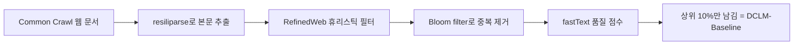
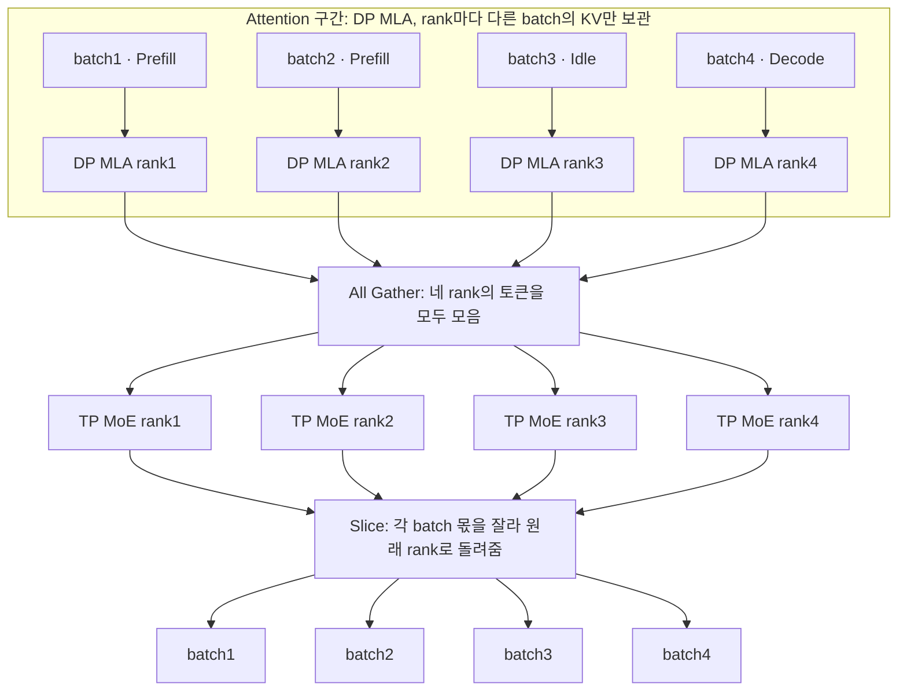

# W02 — Llama 2 모임 Q&A

[W02 주차 페이지](README.md) · 모임: 2026-10-24(토) · 기록: 모임 채팅 · 모임 뒤 별도로 전달된 추가 설명 1건(MLA·DP Attention, 그림 1장)

모임 채팅에 남은 질문과 의견을 발표 파트별로 묶었습니다. 항목마다 **모임에서**는 그때 채팅에 나온 말만 옮긴 것이고(MLA·DP Attention 항목에는 모임 뒤 추가 설명도 따로 표시해 옮겼습니다), **보충**은 모임 뒤에 원문 논문과 공식 문서로 확인한 내용입니다(해석·계산·원문 미기술은 따로 표시했습니다). 질문하거나 의견을 낸 사람의 이름은 적지 않았습니다.

**목차**

- [Tokenizer · Data](#tokenizer--data)
- [Architecture & Pre-training · 추론 · 분산 학습](#architecture--pre-training--추론--분산-학습)
- [Post-training (SFT · 선호 데이터 · GAtt · 평가)](#post-training-sft--선호-데이터--gatt--평가)
- [Alignment & RL (RM · Rejection Sampling · PPO)](#alignment--rl-rm--rejection-sampling--ppo)
- [후속으로 볼 것](#후속으로-볼-것)

## Tokenizer · Data

### 의견: 토크나이저를 너무 크게 가면 문제가 있었는데, 데이터를 크게 늘린 뒤로는 그 얘기가 조용히 사라진 것 같다

**모임에서:** 모임 초반에 한 참가자가 의견을 냈습니다. 그런 토크나이저를 너무 크게 가면 문제가 있었던 것 같은데, 데이터를 엄청 늘리는 시기가 지나고 나서는 그 문제가 조용히 사라진 것 같다는 내용입니다. 채팅만으로는 '크게'가 어휘(vocabulary) 크기를 말하는지, '문제'가 구체적으로 무엇인지 분명하지 않습니다. 모임에서 답이 기록되지 않았습니다.

**보충:** 아래 내용은 '크게'를 어휘 크기로 읽고 확인한 것입니다.

1. **Llama 2는 tokenizer를 바꾸지 않았습니다.** §2.2 Tokenizer에 따르면 LLaMA 1과 같은 tokenizer를 씁니다. 규칙은 세 가지입니다. ① SentencePiece로 구현한 BPE(Byte Pair Encoding)를 쓰고, ② 숫자는 한 자리씩 나누며, ③ 어휘에 없는 UTF-8 문자는 바이트로 쪼갭니다. 전체 어휘는 32k입니다. LLaMA 1 논문 §2.1에도 같은 세 규칙이 있지만 어휘 크기는 적혀 있지 않습니다(원문 미기술). 그래서 LLaMA 1의 어휘가 32k라는 사실은 Llama 2 논문의 "같은 tokenizer"라는 문장을 근거로 확인한 것입니다. LLaMA 1의 공식 설정 파일은 열어 보지 않아, 그 파일로는 확인하지 못했습니다.
2. **이후 보고서들은 어휘와 데이터를 함께 키웠습니다.**

   | 모델 (arXiv) | tokenizer | 어휘 크기 | 사전학습 데이터 |
   |---|---|---|---|
   | LLaMA 1 (2302.13971) | SentencePiece BPE | 원문 미기술 (Llama 2 기준 32k) | 1.0T / 1.4T 토큰 |
   | Llama 2 (2307.09288) | LLaMA 1과 같음 | 32k | 2.0T 토큰 |
   | Qwen (2309.16609) | tiktoken(OpenAI 모델용 공개 BPE tokenizer)의 cl100k_base 어휘에서 시작해 중국어 등 추가, 숫자 한 자리 | 약 152K | 최대 3T 토큰 규모 데이터셋 |
   | Qwen2 (2407.10671) | Qwen과 같은 byte-level BPE | 일반 토큰 151,643 + 제어 토큰 3 | 7T 토큰 이상 |
   | Llama 3 (2407.21783) | tiktoken 100K + 비영어 28K | 128K | 약 15T 토큰 |

3. **Llama 3가 tokenizer를 바꾼 이유로 직접 밝힌 것은 두 가지입니다(§3.2).**
   - 압축률: 영어 표본에서 토큰 하나에 담기는 글자 수가 3.17개에서 3.94개로 늘었습니다. 계산: 영어 1,000글자는 1,000 ÷ 3.17 ≈ 315토큰이었다가 1,000 ÷ 3.94 ≈ 254토큰이 됩니다. 254 ÷ 315 ≈ 0.81이므로 토큰이 약 19% 줄어듭니다. 원문은 그 덕분에 같은 학습 계산량으로 더 많은 글을 '읽을' 수 있다고 설명합니다.
   - 비영어 지원: 일부 비영어 언어의 토큰 28K를 더했더니 압축률과 downstream 성능이 함께 좋아졌고, 영어 토큰화는 영향을 받지 않았다고 적혀 있습니다.
   - "데이터가 늘어서 큰 어휘의 문제가 사라졌다"는 설명은 Llama 3 원문에 없습니다(원문 미기술).
4. **큰 어휘의 문제는 실제 연구 주제입니다(외부 연구).** Tao et al.(2024, NeurIPS 2024)의 정리는 이렇습니다. 어휘가 크면 같은 문장을 더 적은 토큰으로 자를 수 있습니다. 대신 드문 토큰이 충분히 학습되지 못할(under-fitting) 위험이 커지고, 데이터가 적으면 늘어난 어휘 파라미터를 제대로 학습시키지 못합니다. 추론 계산량도 늘어납니다. 이 논문의 결론은 최적 어휘 크기가 계산 예산에 따라 커지고, 대부분의 LLM(Large Language Model)은 어휘가 너무 작다는 것입니다. Llama2-70B의 최적 어휘는 최소 216K로 추정했는데, 실제 32K의 약 7배입니다. Qwen §2.2에도 어휘를 키워도 downstream 성능이 떨어지지 않는지 예비 실험으로 확인했다는 문장이 있습니다. 큰 어휘가 성능을 해칠 수 있다는 우려가 당시에 있었다는 방증으로 읽을 수 있습니다(해석).
5. **계산 · 해석:** 어휘 한 칸이 평균 몇 개의 학습 토큰을 받는지 거칠게 계산해 봤습니다. 128K는 128,000으로 놓았습니다. Llama 2는 2.0T ÷ 32,000 = 6,250만 개이고, Llama 3는 15T ÷ 128,000 ≈ 1억 1,700만 개입니다. 어휘는 4배가 됐지만 데이터가 15 ÷ 2 = 7.5배로 늘어서, 한 칸이 받는 평균 토큰은 오히려 약 1.9배 늘었습니다. 실제 토큰 빈도는 고르지 않으므로 평균은 거친 지표일 뿐입니다. 모임에서 나온 직관과 Tao et al.의 결론은 방향이 같습니다. 하지만 Meta가 이 이유로 어휘를 바꿨다는 기록은 확인하지 못했습니다.

- 원문: [Llama 2 §2.2 Tokenizer · p.6](https://arxiv.org/pdf/2307.09288v2#page=6) · [Llama 2 Table 1 · p.6](https://arxiv.org/pdf/2307.09288v2#page=6) · [LLaMA 1 §2.1 Tokenizer · p.2](https://arxiv.org/pdf/2302.13971v1#page=2) · [Qwen §2.1–2.2 · p.6](https://arxiv.org/pdf/2309.16609v1#page=6) · [Qwen2 §2.1 · p.3](https://arxiv.org/pdf/2407.10671v4#page=3) · [Llama 3 §3.2 (arXiv)](https://arxiv.org/abs/2407.21783v3) · [Tao et al. 2024, Scaling Laws with Vocabulary (arXiv)](https://arxiv.org/abs/2407.13623)
- 슬라이드: [통합 덱 p.74](index.html#s74) · [통합 덱 p.75](index.html#s75) · [팀원 원본 · Tokenizer](slides/tokenizer-bpe.html)

### 의견: 조사에 따른 차이를 구분해야 하지 않나, 다국어 모델을 만들 때는 문화 구분이 필요하다

**모임에서:** 모임 초반에 나온 참가자 의견 두 가지가 메모로 남아 있습니다.

- 조사에 따른 차이를 구분해야 하지 않느냐는 의견이 나왔습니다. 메모를 남긴 참가자가 예시를 준비하겠다고 답했습니다.
- 다국어 모델을 만들 때 문화 구분이 필요하다는 의견도 나왔습니다. 여기에 메모를 남긴 참가자가 요즘 트렌드는 그 부분을 잘 고려하지 않는 것 같다고 답했습니다.

메모가 짧아서 '조사'가 한국어 조사(은·는·이·가 등)를 뜻하는지, 어떤 예시를 두고 한 말인지는 채팅만으로 분명하지 않습니다.

**보충:** 채팅 시각과 앞뒤 메시지로 보면 tokenizer 이야기 중에 나온 말로 보여서, 아래에서는 '조사'를 한국어 조사로 읽었습니다(해석).

- **Llama 2 원문은 한국어나 조사를 따로 다루지 않습니다(원문 미기술).** 원문이 밝히는 것은 사전학습 데이터의 언어 분포입니다. §4.1 Language Identification에서는 fastText 언어 판별기로 문서를 분류했고, 판별 임계값은 0.5입니다. Table 10에는 전체 문서의 0.005% 이상에서 나타난 언어만 실려 있습니다.

  | 행 | 언어 (Table 10의 위에서부터 ko까지 16행) | 비율 (문서 기준) |
  |---|---|---|
  | 1 | en 영어 | 89.70% |
  | 2 | unknown (일부는 프로그래밍 코드) | 8.38% |
  | 3 | de 독일어 | 0.17% |
  | 4 | fr 프랑스어 | 0.16% |
  | 5 | sv 스웨덴어 | 0.15% |
  | 6 | zh 중국어 | 0.13% |
  | 7 | es 스페인어 | 0.13% |
  | 8 | ru 러시아어 | 0.13% |
  | 9 | nl 네덜란드어 | 0.12% |
  | 10 | it 이탈리아어 | 0.11% |
  | 11 | ja 일본어 | 0.10% |
  | 12 | pl 폴란드어 | 0.09% |
  | 13 | pt 포르투갈어 | 0.09% |
  | 14 | vi 베트남어 | 0.08% |
  | 15 | uk 우크라이나어 | 0.07% |
  | 16 | ko 한국어 | 0.06% |

  - 원문 Table 10에는 ko 아래로 ca·sr(0.04%), id·cs·fi·hu·no·ro(0.03%), bg·da(0.02%), sl·hr(0.01%)이 더 있습니다.
  - 세어 보면 한국어는 표의 16번째 행이고, en과 unknown을 빼면 14번째 언어입니다.
  - 계산: 영어와 unknown을 뺀 나머지 언어를 모두 합하면 100 − 89.70 − 8.38 = 1.92%입니다. 영어 ÷ 한국어 = 89.70 ÷ 0.06 ≈ 1,495이므로, 영어 문서가 한국어 문서보다 약 1,500배 많습니다.
  - 단위가 문서 비율이라서 한국어 토큰이 몇 개인지는 알 수 없습니다(원문 미기술).
- **원문이 밝힌 다국어 한계:**
  - §4.1: 말뭉치 대부분이 영어이므로 다른 언어에는 맞지 않을 수 있다고 적었습니다. Table 10 설명에도 영어로 쓸 때 가장 잘 동작한다고 되어 있습니다.
  - §5.2: 다른 언어 실력이 제한적인 주된 이유로 비영어 사전학습 데이터가 적다는 점(Table 10)을 듭니다. 그래서 영어 밖 성능은 불안정하니 조심해서 쓰라고 합니다. 공개 데이터셋이 없는 비영어 언어에서는 유해성·편향 문제가 남을 수 있다는 언급도 있습니다.
  - LLaMA 1(§2.1): CommonCrawl에서는 fastText로 비영어 페이지를 걸러냈고, Wikipedia는 라틴 문자나 키릴 문자를 쓰는 20개 언어만 넣었습니다. 이 20개 언어에 한국어는 없습니다.
- **조사(형태소) 경계(외부 연구):** Park et al.(2020, AACL)은 한국어 tokenization 방식을 비교했습니다. 형태소 분할을 먼저 하고 BPE를 거는 혼합 방식이 한↔영 번역과 KorNLI·KorSTS·NSMC·PAWS-X에서 가장 좋았습니다. BPE만 쓴 방식이 더 나은 과제는 KorQuAD 하나였습니다. 조사도 형태소 단위이므로 이런 방식에서는 조사가 따로 떨어져 나옵니다(해석).
- **문화 쪽:** Llama 2가 문화와 관련해 밝힌 것은 사전학습 말뭉치의 인구 집단 표현 분석(Table 9) 하나뿐입니다. 표 설명에는 서구 인구 집단이 더 많이 나타나는 쏠림이 있다고 적혀 있습니다.
  - 국적 축으로 계산해 봤습니다. 국적 단어를 언급한 문서는 전체의 14.83%이고, 그 안에서 american이 69.4%, korean이 5.1%입니다. 전체 문서를 기준으로 바꾸면 american은 14.83% × 0.694 ≈ 10.3%, korean은 14.83% × 0.051 ≈ 0.76%입니다(계산).
  - 다국어 데이터를 문화별로 나눠 처리했다는 설명은 없습니다(원문 미기술).
- **후속 보고서:** Llama 3 §4.3.2(다국어 post-training, p.22)를 보면 다음과 같습니다.
  - 다국어 instruction 데이터를 따로 마련한 언어는 독일어·프랑스어·이탈리아어·포르투갈어·힌디어·스페인어·태국어 7개입니다. 한국어는 이 목록에 없습니다.
  - 기계 번역 데이터는 미세조정에 되도록 쓰지 않으려 했다고 적었습니다. 번역투(translationese)와 이름·성별·문화 편향을 막고, 모델이 영어 문화권에 뿌리를 둔 과제에만 노출되지 않게 하려는 것이라고 합니다.
  - 다만 예외가 하나 있습니다. 비영어 정량 추론 성능을 높이려고 합성 정량 추론 데이터만은 번역해서 썼습니다.
  - 다국어 SFT 데이터 구성은 사람 주석 2.4%, 다른 NLP 과제 데이터 44.2%, rejection sampling 데이터 18.8%, 번역한 추론 데이터 34.6%입니다. 계산: 2.4 + 44.2 + 18.8 + 34.6 = 100.0%이고, 번역 데이터는 사람 주석의 34.6 ÷ 2.4 ≈ 14배입니다. 사람 주석(언어학자·원어민이 직접 주석)이 번역을 대신한 것은 아닙니다.
  - 해석: 적어도 Llama 3는 문화 편향을 명시적으로 고려할 대상으로 적었으므로, 요즘은 문화를 잘 고려하지 않는다는 말이 Llama 3 보고서에는 그대로 들어맞지 않습니다. 다만 실제 데이터의 대부분은 사람 주석이 아니라 다른 과제 데이터와 번역 데이터입니다(계산: 44.2 + 34.6 = 78.8%). 업계 전반의 동향은 확인하지 못했습니다.

- 원문: [Llama 2 §4.1 Language Identification · p.21](https://arxiv.org/pdf/2307.09288v2#page=21) · [Llama 2 Table 10 · p.22](https://arxiv.org/pdf/2307.09288v2#page=22) · [Llama 2 Table 9 · p.21](https://arxiv.org/pdf/2307.09288v2#page=21) · [Llama 2 §5.2 · p.34](https://arxiv.org/pdf/2307.09288v2#page=34) · [LLaMA 1 §2.1 · p.2](https://arxiv.org/pdf/2302.13971v1#page=2) · [Llama 3 §4.3.2 · p.22](https://arxiv.org/pdf/2407.21783v3#page=22) · [Park et al. 2020 (ACL Anthology)](https://aclanthology.org/2020.aacl-main.17/)
- 슬라이드: [통합 덱 p.76](index.html#s76) · [통합 덱 p.77](index.html#s77) · [통합 덱 p.93](index.html#s93) · [팀원 원본 · Tokenizer](slides/tokenizer-bpe.html) · [팀원 원본 · Data](slides/llama2_data.html)

### 의견: Llama 2 Data 파트는 실험과 디테일이 적다 — 품질이 중요하지 않아서가 아니라 숨긴 것 같다

**모임에서:** 데이터 파트를 두고 확실히 내용이 없다, 실험과 디테일이 별로 없다는 의견이 이어졌습니다. 정리 메모에는 두 가지가 남았습니다.

- RedPajama가 재현할 수 있을 만큼 LLaMA 1은 내용이 좋았는데, Llama 2는 너무 부실하다.
- 데이터 품질 이야기는 LLaMA 1에 나온다. 그렇다고 품질이 중요하지 않다는 뜻은 아니고, 중요한데 숨기는 것 같다.

**보충:**

- **Llama 2가 밝힌 것 (§2, §2.1, §4.1, Table 52):**
  - LLaMA 1에서 바꾼 점 가운데 데이터 관련은 세 가지입니다. 정제를 더 강하게 했고("more robust data cleaning"), 데이터 혼합을 새로 짰고, 총 토큰을 40% 늘렸습니다.
  - 계산: '40% 증가'는 큰 모델 기준으로 1.4T에서 2.0T로 늘어난 것입니다. (2.0 − 1.4) ÷ 1.4 ≈ 0.43이니 약 43%입니다. 7B·13B는 1.0T에서 2.0T로 늘었으므로 2배입니다(Table 1).
  - 공개 출처를 새로 섞은 데이터이고, Meta 제품·서비스 데이터는 들어 있지 않습니다. 사적인 개인정보가 많다고 알려진 일부 사이트의 데이터는 빼려고 노력했다고 합니다.
  - 2T 토큰을 고른 이유는 성능과 비용의 균형이 좋아서입니다. 지식을 늘리고 환각을 줄이려고 가장 사실적인 출처를 up-sampling했습니다.
  - §4.1: 데이터셋마다 Meta의 개인정보·법무 검토를 거쳤고, 그 밖의 추가 필터링은 하지 않았습니다. 혐오 표현 분류 같은 과제에도 모델을 쓸 수 있게 하고, 데이터를 과하게 지우다가 특정 인구 집단이 사라지는 일을 피하려는 선택이었습니다. 독성 점수가 0.5 이상인 문서는 약 0.2%입니다(Figure 13).
  - 데이터 기준 시점은 2022년 9월입니다(Table 52 모델 카드).
  - §2.1(p.5)은 사용자가 모델의 능력과 한계를 이해할 수 있도록 사전학습 데이터를 여러모로 조사했고, 그 결과를 §4.1에 실었다고 적었습니다. §4.1(p.20)은 첫머리에서 사전학습 데이터의 언어 분포·인구 집단 표현·독성을 분석한다고 밝힙니다. 즉 공개한 것은 데이터를 만드는 레시피가 아니라 분석 결과입니다(해석).
- **밝히지 않은 것:** 출처 이름과 비율, 정제 방법과 임계값, 어떤 출처를 얼마나 up-sampling했는지는 나오지 않습니다. 왜 공개하지 않았는지는 원문 미기술입니다. 그러니 '숨긴다'는 모임의 해석이고, 그런 의도가 있었는지는 논문으로 확인할 수 없습니다.
- **LLaMA 1 Table 1과 비교:**

  | 출처 | LLaMA 1 샘플링 비율 | epoch (1.4T 학습) | 디스크 크기 | Llama 2 |
  |---|---|---|---|---|
  | CommonCrawl | 67.0% | 1.10 | 3.3 TB | 미공개 |
  | C4 | 15.0% | 1.06 | 783 GB | 미공개 |
  | GitHub | 4.5% | 0.64 | 328 GB | 미공개 |
  | Wikipedia | 4.5% | 2.45 | 83 GB | 미공개 |
  | Books | 4.5% | 2.23 | 85 GB | 미공개 |
  | ArXiv | 2.5% | 1.06 | 92 GB | 미공개 |
  | StackExchange | 2.0% | 1.03 | 78 GB | 미공개 |

  - 계산: 비율을 모두 더하면 67.0 + 15.0 + 4.5 + 4.5 + 4.5 + 2.5 + 2.0 = 100.0%입니다.
  - LLaMA 1은 출처마다 정제 방법도 적었습니다. 예를 들어 CommonCrawl은 CCNet 파이프라인을 거쳤습니다. 줄 단위로 중복을 지우고, fastText로 비영어를 걸러내고, n-gram 언어 모델로 저품질 글을 걸러내는 순서입니다. 여기에 Wikipedia가 참조하는 페이지를 가려내는 분류기를 더했습니다. GitHub는 Apache·BSD·MIT 라이선스 프로젝트만 남겼습니다.
- **RedPajama가 재현한 것:**
  - Together는 2023-04-17에 1.2T 토큰이 넘는 LLaMA 학습 데이터셋을 재현했다고 발표했습니다.
  - RedPajama 논문(Weber et al., NeurIPS 2024 Datasets and Benchmarks)은 V1을 LLaMA 학습 데이터의 공개 재현이라고 부릅니다. Table 2의 출처별 토큰은 CommonCrawl 878B, C4 175B, GitHub 59B, Books 26B, ArXiv 28B, Wikipedia 24B, StackExchange 20B입니다. 계산: 878 + 175 + 59 + 26 + 28 + 24 + 20 = 1,210B ≈ 1.2T.
  - 다만 원문을 확인하면 LLaMA 1도 그대로 재현할 수 있는 수준은 아니었습니다. RedPajama 논문 §3.1에 따르면 LLaMA 논문은 어떤 CommonCrawl snapshot을 썼는지, 분류기를 어떻게 만들었는지 밝히지 않아서 RedPajama가 직접 정해야 했습니다. Books3는 저작권 문제로 내렸고, Wikipedia 덤프 시점도 다릅니다.
  - §3.2.2에 따르면 이렇게 만든 데이터로 학습한 7B base 모델은 HELM(Holistic Evaluation of Language Models)-classic에서 LLaMA-7B보다 4.1점 낮았습니다. 저자들은 원인 후보로 두 가지를 듭니다. 하나는 FP16(16비트 부동소수점)으로 학습하느라 학습률을 낮춘 점이고, 다른 하나는 데이터셋이 원본과 조금 달라진 점입니다.
  - 정리하면 LLaMA 1은 레시피를 따라 비슷하게 만들 수 있을 만큼은 공개했고, Llama 2는 그 정도도 공개하지 않았다고 보는 편이 더 정확합니다(해석).
- **후속 보고서:**
  - Llama 3 §3.1에는 범주별 최종 혼합 비율이 있습니다. 일반 지식 약 50%, 수학·추론 25%, 코드 17%, 다국어 8%로 합이 100%입니다. 모델 기반 품질 필터를 썼다는 설명도 있습니다.
  - Qwen2 §3.1에는 품질 기준을 완화해 데이터를 12T 토큰으로 늘려 봤더니, 그 데이터로 학습한 모델이 7T 모델보다 뚜렷이 낫지 않았다는 기록이 있습니다. 데이터 양을 늘린다고 꼭 이득은 아니라는 것입니다.
  - 두 기록 모두 품질이 중요하다는 모임 의견과 방향이 같습니다(해석).

- 원문: [Llama 2 §2 · §2.1 · p.5](https://arxiv.org/pdf/2307.09288v2#page=5) · [Llama 2 Table 1 · p.6](https://arxiv.org/pdf/2307.09288v2#page=6) · [Llama 2 §4.1 Steps Taken · p.20](https://arxiv.org/pdf/2307.09288v2#page=20) · [Llama 2 Figure 13 · p.21](https://arxiv.org/pdf/2307.09288v2#page=21) · [Llama 2 Table 52 · p.77](https://arxiv.org/pdf/2307.09288v2#page=77) · [LLaMA 1 §2.1 · Table 1 · p.2](https://arxiv.org/pdf/2302.13971v1#page=2) · [RedPajama 논문 §3 · Table 2 (arXiv)](https://arxiv.org/abs/2411.12372) · [Together 블로그 · RedPajama 발표 (2023-04-17)](https://www.together.ai/blog/redpajama) · [Llama 3 §3.1 (arXiv)](https://arxiv.org/abs/2407.21783v3) · [Qwen2 §3.1 · p.6](https://arxiv.org/pdf/2407.10671v4#page=6)
- 슬라이드: [통합 덱 p.87](index.html#s87) · [통합 덱 p.88](index.html#s88) · [통합 덱 p.92](index.html#s92) · [통합 덱 p.94](index.html#s94) · [팀원 원본 · Data](slides/llama2_data.html)

### 의견: DCLM을 Background로 정리하고, 어떤 Technical Report에서 나왔는지 보자 (후속 과제)

**모임에서:** 데이터 이야기를 하다가 DCLM이 언급됐습니다. Nemotron-CC나 RedPajama v2 같은 후속 작업에서 많이 언급되는 것 같다는 메모도 남았습니다. 이어서 DCLM의 Background와 "어떤 Technical Report에서 나왔는지"를 정리해 보면 좋겠다는 제안이 나왔습니다. 채팅만으로는 '나왔는지'가 DCLM이 처음 나온 문헌을 말하는지, DCLM을 가져다 쓴 보고서를 말하는지 분명하지 않아서 아래에 둘 다 정리했습니다. DCLM이 무엇인지에 대한 설명은 모임에서 기록되지 않았습니다.

**보충:**

**DCLM이 처음 나온 문헌.** DataComp-LM 논문입니다(Li et al., arXiv 2406.11794, v1 2024-06-17, v4 2025-04-21). arXiv 페이지에 학회 표기가 없어, 학회에 게재됐는지는 확인하지 못했습니다.

- 논문은 DCLM을 언어 모델을 더 좋게 만들 학습 데이터를 통제된 실험으로 찾는 testbed(시험대)라고 소개합니다.
- Common Crawl에서 뽑은 표준 말뭉치 DCLM-Pool을 제공합니다. 240T 토큰, 약 2,000억 문서 규모이고, 2023년 이전 Common Crawl 전체가 들어 있습니다.
- 실험은 412M부터 7B까지의 모델 크기에서 합니다.
- 핵심 결론은 고품질 학습셋을 만드는 열쇠가 모델 기반 필터링이라는 것입니다.

**DCLM-Baseline을 만드는 순서 (§4)**

- fastText 분류기의 양성 예시는 두 가지입니다. OpenHermes 2.5(OH-2.5)의 instruction 형식 데이터와, r/ExplainLikeImFive(ELI5)에서 점수가 높은 글입니다. 음성 예시는 RefinedWeb 재현본에서 무작위로 뽑았습니다. 약 40만 문서를 양성과 음성 절반씩으로 학습했습니다.
- 같은 조건에서 다른 필터와도 비교했습니다. PageRank, SemDedup, BGE 임베딩 분류기, AskLLM, perplexity 필터, top-k 평균 logit 가운데 fastText 필터가 가장 좋았습니다. Table 4의 Core 점수로 fastText 30.2, perplexity 29.0, AskLLM 28.6, PageRank 26.1입니다.
- 결과: 7B 모델을 2.6T 토큰으로 학습해 MMLU(Massive Multitask Language Understanding) 5-shot 64%를 얻었습니다. MAP-Neo보다 6.6%p 높은데 계산량은 40% 적었습니다. Mistral-7B-v0.3(63%), Llama 3 8B(66%)와 비슷한 점수이고, 계산량은 Llama 3 8B의 6.6분의 1이었다고 합니다.
- Llama 계열과의 연결(해석): LLaMA 1은 CommonCrawl을 CCNet 파이프라인으로 처리한 뒤, 추가로 Wikipedia가 참조하는 페이지와 무작위 페이지를 가르는 선형 분류기를 학습해 걸렀습니다(LLaMA 1 §2.1). Llama 3는 Wikipedia가 참조할 만한 글인지 맞히는 fastText 분류기와, Llama 2가 매긴 판정으로 학습한 DistilRoBERTa 분류기를 썼습니다(Llama 3 §3.1.1). 셋 다 '좋은 글처럼 보이는가'를 분류기로 고르는 같은 계열입니다. DCLM이 다른 점은 두 가지입니다. 양성 예시를 instruction 형식 데이터로 잡았고, 여러 필터를 같은 조건에서 비교했습니다.

**Nemotron-CC와의 관계 (Su et al., arXiv 2412.02595, ACL 2025).** DCLM을 비판하면서 동시에 가져다 씁니다.

- 비판: FineWeb-Edu와 DCLM은 공격적인 모델 기반 필터링으로 점수를 올렸지만, 그 대가로 데이터의 90%를 버렸습니다. 게다가 남은 데이터의 약 80%가 거의 같은 문서(near-duplicate)입니다. 그래서 15T 토큰처럼 긴 학습에는 맞지 않는다고 봅니다.
- 사용: 품질 분류기 세 개를 앙상블했는데, 그중 하나가 DCLM이 공개한 fastText 분류기입니다(§2.2). 나머지 둘은 Mistral 8x22B-instruct와 Nemotron-340B-instruct가 단 주석으로 학습한 회귀 모델입니다.
- 비교: 고품질 부분집합으로 8B 모델을 1T 토큰 학습했을 때 MMLU가 DCLM보다 5.6점 높았습니다. 전체 데이터 6.3T 토큰은 전역 중복 제거를 거친 실제 토큰 4.4T와 합성 토큰 1.9T로 이뤄져 있습니다(계산: 4.4 + 1.9 = 6.3). 고유한 실제 토큰이 DCLM의 4배라고 적혀 있습니다. 15T 토큰(그중 7.2T가 이 데이터)으로 학습한 8B 모델은 Llama 3.1 8B보다 MMLU가 5점 높았습니다.

**RedPajama v2와의 관계 (시간 순서 주의).**

- RedPajama-Data-v2는 2023-10-30 발표 글에서 소개됐습니다. Common Crawl dump 84개, 언어 5개(영어·프랑스어·스페인어·독일어·이탈리아어), 품질 신호 40개 이상, 중복 제거 후 30T 토큰 규모입니다.
- DCLM v1(2024-06-17)보다 먼저 나왔으므로, RedPajama v2 데이터 자체가 DCLM을 쓸 수는 없었습니다. 오히려 DCLM 논문 §2가 RedPajama-v2(30T)를 기존 공개 데이터셋 가운데 하나로 언급합니다.
- 나중에 나온 RedPajama 논문(2024-11)은 Table 1의 공개 데이터셋 목록에 DCLM-baseline과 DCLM-Pool을 넣었습니다. 하지만 확인한 범위의 본문에서는 DCLM을 따로 논의하지 않습니다. 논문 뒷부분(약 2.6만 자)과 RedPajama v2 자료는 끝까지 읽지 않아, 그곳에서 DCLM을 더 다루는지는 확인하지 못했습니다.
- 해석: 확인한 범위에서는 RedPajama v2 쪽에서 DCLM이 많이 언급된다기보다, 서로를 기존 데이터셋으로 인용하는 관계로 보입니다. 끝까지 읽지 않은 부분은 확인하지 못했습니다. 확인한 자료 가운데 DCLM을 직접 가져다 쓴 것이 분명한 쪽은 Nemotron-CC입니다.

**DCLM을 쓴 technical report (확인한 것만)**

| 보고서 | DCLM을 어떻게 썼나 |
|---|---|
| OLMo 2 (arXiv 2501.00656) | 사전학습 혼합 OLMo 2 Mix 1124의 전체 3.90T 토큰 가운데 DCLM-Baseline 1.0이 3.71T입니다(계산: 3.71 ÷ 3.90 ≈ 95%, Table 4). mid-training 혼합(Dolmino)에도 DCLM-Baseline 부분집합(752B 토큰)이 들어갑니다. Table 5에는 거른 기준이 'FastText top 7%'(DCLM fastText 분류기 기준)와 'FineWeb ≥2'(FineWeb-Edu 분류기 점수 2 이상)로 적혀 있어, 두 분류기를 함께 적용했습니다. 본문(§4.3)은 DCLM fastText 분류기 임계값을 0.03311014로 두고, 여기에 FineWeb-Edu 분류기 점수를 결합했다고 설명합니다. 표 번호는 arXiv v3 기준입니다(v1에서는 같은 표가 Table 1·Table 2). |
| Nemotron-CC (arXiv 2412.02595) | 품질 분류기 앙상블의 구성원 하나이자 비교 기준선으로 썼습니다. |
| DCLM 논문이 직접 꼽은 후속 작업 | DCLM v4 §2는 WebOrganizer, Nemotron-CC, Olmo-2가 DCLM의 벤치마크나 정제 전략을 토대로 만들어졌다고 적습니다. WebOrganizer 원문은 열어 보지 않아, 어떻게 썼는지는 확인하지 못했습니다. |
| Qwen · Qwen2 (W03 자료) | 본문을 텍스트로 검색했을 때 DCLM·DataComp 언급이 없습니다. Qwen(arXiv 2309)은 DCLM보다 먼저 나왔습니다. |

표에 적은 것 밖의 보고서가 DCLM을 썼는지는 확인하지 못했습니다.

- 원문: [DataComp-LM (DCLM) (arXiv)](https://arxiv.org/abs/2406.11794) · [Nemotron-CC (arXiv)](https://arxiv.org/abs/2412.02595) · [RedPajama 논문 (arXiv)](https://arxiv.org/abs/2411.12372) · [Together 블로그 · RedPajama-Data-v2 (2023-10-30)](https://www.together.ai/blog/redpajama-data-v2) · [OLMo 2 기술 보고서 Table 4·5 · §4.3 (arXiv v3)](https://arxiv.org/abs/2501.00656v3) · [LLaMA 1 §2.1 · p.2](https://arxiv.org/pdf/2302.13971v1#page=2) · [Llama 3 §3.1.1 (arXiv)](https://arxiv.org/abs/2407.21783v3)
- 슬라이드: [통합 덱 p.97](index.html#s97) (Llama 3의 모델 기반 품질 필터, DCLM과 비교할 맥락) · [팀원 원본 · Data](slides/llama2_data.html)

## Architecture & Pre-training · 추론 · 분산 학습

### Q. Chinchilla scaling law가 Llama 2에서는 왜 깨졌다고 보나요?

**모임에서:** 발표에서 Chinchilla scaling law가 나온 뒤, Llama 2에서는 왜 그 법칙이 깨졌다고 보는지 묻는 질문이 있었습니다. 모임에서 답이 기록되지 않았습니다.

**보충:** 원문을 근거로 보면 '깨졌다'보다 '목표가 달랐다'고 보는 편이 정확합니다.

1. **Chinchilla가 실제로 말한 것.** 정해진 학습 계산량 C 안에서 loss가 가장 낮아지는 모델 크기 N(파라미터 수)과 학습 토큰 수 D의 조합을 찾는 것이 목표입니다(§1). 결론은 모델 크기와 토큰 수를 같은 비율로 늘려야 한다는 것, 즉 모델이 2배가 되면 토큰도 2배가 되어야 한다는 것입니다(초록). 이 결론을 확인하려고 70B 모델을 1.4T 토큰으로 학습한 모델이 Chinchilla입니다(§1, §4).
   - 계산: 1.4T ÷ 70B = 1.4×10¹² ÷ 7×10¹⁰ = **20 토큰/파라미터**
   - Table 3(§3.4, Approach 1 추정)은 1B → 20.2B, 10B → 205.1B, 67B → 1.5T 토큰을 제시합니다. 계산하면 각각 20.2, 20.5, 약 22.4 토큰/파라미터입니다. 흔히 말하는 '약 20배'는 이 값들을 반올림한 경험칙입니다.
2. **Llama 2의 토큰/파라미터.** Table 1을 보면 네 크기 모두 2.0T 토큰을 학습했습니다. 아래 값은 명목 크기(7B 등)로 계산했습니다.

   | 크기 | 학습 토큰 | 토큰/파라미터 (계산) | Chinchilla식 20배 토큰 (계산) | 실제 ÷ 20배 (계산) |
   |---|---|---|---|---|
   | 7B | 2.0T | 2,000B ÷ 7B ≈ 286 | 7B × 20 = 140B | 2,000 ÷ 140 ≈ 14.3배 |
   | 13B | 2.0T | 2,000 ÷ 13 ≈ 154 | 13B × 20 = 260B | 2,000 ÷ 260 ≈ 7.7배 |
   | 34B | 2.0T | 2,000 ÷ 34 ≈ 59 | 34B × 20 = 680B | 2,000 ÷ 680 ≈ 2.9배 |
   | 70B | 2.0T | 2,000 ÷ 70 ≈ 29 | 70B × 20 = 1,400B | 2,000 ÷ 1,400 ≈ 1.4배 |

3. **같은 학습비라면 Chinchilla 기준으로는 어떤 모델이 나올까 (계산).** Chinchilla는 학습 계산량을 FLOPs ≈ 6ND로 근사합니다(§3.3). 이 근사식은 §3.3에서 확인했고, FLOPs 유도가 있는 Appendix F는 열어 보지 않았습니다.
   - Llama 2 7B의 학습량: 6 × (7×10⁹) × (2.0×10¹²) = 8.4×10²² FLOPs
   - 여기에 D = 20N을 넣으면 6 × N × 20N = 120N² = 8.4×10²²이므로 N² = 7.0×10²⁰, N ≈ 2.6×10¹⁰(약 26B), D ≈ 20 × 26B ≈ 0.53T입니다.
   - 같은 학습비로 Chinchilla 기준은 '26B 모델을 약 0.53T 토큰으로 학습'하라고 하는 셈입니다. Llama 2는 그 대신 약 1/3.8 크기인 7B를 2.0T 토큰으로 학습했습니다.
   - 70B에 같은 계산을 하면 8.4×10²³ FLOPs → N ≈ 84B, D ≈ 1.7T가 나와 Chinchilla 기준과 거의 같습니다. 즉 모델이 작을수록 기준에서 더 많이 벗어납니다.
4. **일부러 벗어난 이유: LLaMA 1 §1의 논리.** LLaMA 1은 Hoffmann 등(Chinchilla)의 scaling law가 학습 계산 예산만 보고 추론 예산은 고려하지 않는다고 지적합니다. 반면 모델을 대규모로 서비스할 때는 추론 예산이 결정적이라고 봅니다. 그래서 목표 성능이 정해져 있다면 가장 빨리 학습되는 모델보다 추론이 가장 빠른 모델을 선호한다고 씁니다. 또 scaling law는 10B 모델을 200B 토큰으로 학습하라고 권하지만, 실제로는 7B 모델이 1T 토큰을 넘긴 뒤에도 계속 좋아졌다고 보고합니다.
5. **Llama 2 원문이 직접 말한 것.** §2.1은 2T 토큰을 고른 이유를 성능과 비용 사이의 좋은 절충이라고만 적습니다. Figure 5 캡션에는 2T 토큰을 학습한 뒤에도 포화 징후가 없었다고 나옵니다. §6 관련 연구에서는 Chinchilla가 scaling law의 초점을 가중치 수에서 토큰 수로 옮겼고 Llama는 추론 시 계산 효율에 집중한 모델로 알려졌다고 정리합니다. 그러나 Chinchilla를 근거로 토큰 수를 정했다거나 그 법칙을 깼다는 설명은 없습니다(원문 미기술).
6. 해석: Chinchilla의 결론은 '학습비가 정해져 있을 때 크기와 토큰을 어떻게 나눌지'에 대한 답입니다. 20배를 넘기면 loss가 더 내려가지 않는다는 주장은 아닙니다. Figure 5에서 loss가 계속 내려간다는 것은 작은 모델에 학습비를 더 들이면 그만큼 더 좋아진다는 뜻입니다. Llama 2는 학습비를 더 쓰는 대신 추론비를 아끼는 쪽을 골랐습니다. 다음 주에 볼 Qwen도 같은 방향입니다. Table 1에 따르면 7B를 2.4T 토큰(계산: 약 343 토큰/파라미터), 14B를 3.0T 토큰(약 214)으로 학습했습니다.

- 원문: [Llama 2 §2.1 · p.5](https://arxiv.org/pdf/2307.09288v2#page=5) · [Llama 2 Table 1 · Figure 5 · p.6](https://arxiv.org/pdf/2307.09288v2#page=6) · [Llama 2 §6 · p.35](https://arxiv.org/pdf/2307.09288v2#page=35) · [Chinchilla 초록 · §1 · §3.3 · §3.4 Table 3 · §4](https://arxiv.org/abs/2203.15556) · [LLaMA 1 §1](https://arxiv.org/html/2302.13971v1) · [Qwen Table 1 · p.7](https://arxiv.org/pdf/2309.16609v1#page=7)
- 슬라이드: [통합 덱 p.14](index.html#s14) · [통합 덱 p.15](index.html#s15) · [팀원 원본 · 사전학습 & 아키텍처](slides/w02-llama2-pretraining-architecture.html)

### 의견: Peak LR을 높이면 성능은 오르지만 학습이 불안정해진다. Llama 2가 이후의 레퍼런스가 된 것 같다

**모임에서:** 발표 중에 이런 의견이 나왔습니다. peak LR(Learning Rate, 학습률의 최댓값)이 높으면 성능은 좋아지지만 학습이 불안정해지는 문제가 생긴다. 그래서 Llama 2가 좋은 레퍼런스처럼 되었고, 이후 모델들이 Llama 2를 따라가는 식이 된 것 같다. 무엇을 따라갔는지(LR 설정인지 Llama 2 전체인지)는 채팅에 적혀 있지 않습니다.

**보충:** 아래는 원문에 적힌 설정값입니다. 'LR이 높으면 불안정하다'와 '이후 Llama 2를 따라갔다'는 원문으로 확인되지 않아 의견으로 남깁니다. LR과 불안정성의 관계는 다른 1차 출처로도 확인하지 못했습니다.

| 항목 | LLaMA 1 (§2.3, Table 2) | Llama 2 (§2.2, Table 1) | Qwen (§2.4, Table 1) |
|---|---|---|---|
| Optimizer | AdamW β₁ 0.9 · β₂ 0.95 (eps 값은 적혀 있지 않음) | AdamW β₁ 0.9 · β₂ 0.95 · eps 10⁻⁵ | AdamW β₁ 0.9 · β₂ 0.95 · eps 10⁻⁸ |
| Peak LR | 7B·13B 3.0×10⁻⁴ / 33B·65B 1.5×10⁻⁴ | 7B·13B 3.0×10⁻⁴ / 34B·70B 1.5×10⁻⁴ | 1.8B·7B·14B 모두 3.0×10⁻⁴ |
| 스케줄 | warmup 2,000 step → cosine → 최종 LR = 최대값의 10% | 같음 | cosine → 최종 LR = peak의 10% (warmup은 §2.4에 없음) |
| weight decay / clipping | 0.1 / 1.0 | 0.1 / 1.0 | §2.4에 없음 |
| global batch | 4M 토큰 | 4M 토큰 | 4M 토큰 |

- 계산: 최종 LR은 7B·13B가 3.0×10⁻⁴ × 0.1 = 3.0×10⁻⁵, 34B·70B가 1.5×10⁻⁴ × 0.1 = 1.5×10⁻⁵입니다.
- 계산: warmup 2,000 step × 4M 토큰 = 약 8B 토큰으로, 2.0T의 0.4%입니다. 총 step 수는 2.0T ÷ 4M ≈ 50만 step입니다(4M을 4×10⁶으로 본 근사이며, 원문에는 총 step 수가 없습니다).
- Llama 2 §2.2는 사전학습 설정과 구조 대부분을 LLaMA 1에서 그대로 가져왔다고 씁니다. 표를 보면 크기 구간별 peak LR도 LLaMA 1과 같습니다. 큰 모델(34B·70B)에서 peak LR을 절반으로 낮춘 이유, 그리고 LR과 학습 불안정성의 관계는 원문에 없습니다(원문 미기술).
- Qwen은 optimizer, cosine 스케줄, 최종 10%, batch 4M이 Llama 2와 거의 같고 eps만 다릅니다(10⁻⁸). 다만 Qwen 원문에 Llama 2 설정을 따랐다는 문장은 없습니다. 해석: '비슷한 레시피가 이어졌다'까지는 확인되지만, '따라갔다'는 의견으로 보는 것이 안전합니다.

- 원문: [Llama 2 §2.2 · p.5](https://arxiv.org/pdf/2307.09288v2#page=5) · [Llama 2 Table 1 · p.6](https://arxiv.org/pdf/2307.09288v2#page=6) · [LLaMA 1 §2.3 · Table 2](https://arxiv.org/html/2302.13971v1) · [Qwen §2.4 · Table 1 · p.7](https://arxiv.org/pdf/2309.16609v1#page=7)
- 슬라이드: [통합 덱 p.13](index.html#s13) · [팀원 원본 · 사전학습 & 아키텍처](slides/w02-llama2-pretraining-architecture.html)

### Q. MQA는 TP에서 효율이 떨어지는데, GQA도 TP를 늘리면 한계가 분명하지 않나요?

**모임에서:** 질문은 이랬습니다. MQA(Multi-Query Attention)는 TP(Tensor Parallelism, 한 층의 계산을 여러 GPU에 나누는 방식)에서 효율을 내지 못하는데, GQA(Grouped-Query Attention)도 한계가 분명하지 않은가? TP가 커질수록 어려워지지 않는가? 채팅에 남은 답은 다음과 같습니다.

- 그림 기준으로 TP 4까지는 되지만 그 이후로는 안 되는 게 맞다.
- 당시에는 K·V가 충분히 커서 문제가 되지 않았다. 채팅의 'V K 충분히 커서'가 K·V head 수를 말한 것인지 크기를 말한 것인지는 채팅만으로는 모호합니다.
- 나중에 모델이 더 커지면서 이 지점에서 문제가 생기기도 했다. 비슷한 이슈로 MLA(Multi-head Latent Attention)가 언급되었습니다(DP(Data Parallelism) Attention과 SP(Sequence Parallelism)는 다음 항목에서 다룹니다).

**보충:**

용어: KV cache는 이미 처리한 토큰마다 만든 Key·Value 중간값을 GPU 메모리에 저장해 둔 것입니다. 다음 토큰을 생성할 때 이 값을 다시 계산하지 않고 꺼내 씁니다(DistServe §2.1).

1. **원문 내용(A.2.1).**
   - Meta는 지연 시간을 줄이려고 가장 큰 모델을 한 노드의 A100 8장에 TP로 올립니다(Megatron-LM, Shoeybi et al., 2019 인용). 이 경우 MQA는 head 수가 GPU 수보다 적어서 head 단위로 나눌 수 없습니다.
   - 남는 방법은 두 가지입니다. 하나는 K·V를 모든 GPU에 복제하는 것인데, 그러면 KV cache 크기가 GQA와 같아집니다. 다른 하나는 batch 축으로 나누는 것(Pope et al., 2022 인용)인데, batch가 shard 수보다 클 때만 동작하고 추가 통신 비용이 늘 그만한 가치가 있지는 않아 서비스가 복잡해진다고 씁니다.
   - Table 18(30B 모델, 150B 토큰)에서 GQA는 대부분의 과제에서 MHA(Multi-Head Attention)와 비슷했고, 평균으로는 MQA보다 나았습니다.
   - 이 ablation(구성 요소를 빼거나 바꿔 보는 비교 실험) 결과와 추론 확장의 용이성을 근거로 34B·70B에 MQA 대신 GQA를 골랐습니다.
2. **Figure 24는 TP 크기를 바꾼 그림이 아닙니다.** Figure 24는 30B ablation 모델을 A100 80GiB 8장에서 TP로 돌려 얻은 그림입니다. 출력 길이는 128 토큰으로 고정했고, batch를 1부터 2배씩 늘리며 처리량과 토큰당 지연을 비교합니다. MHA는 context 256에서 batch 1024, context 2k에서 batch 128일 때 메모리가 부족해졌고(OOM), MQA·GQA는 같은 조건에서 실행되었습니다. 이 실험에서는 MQA의 KV head를 모든 GPU에 복제했기 때문에 KV cache 크기가 GQA와 같아졌고, 두 방식이 거의 같게 움직였다고 합니다.
   - 해석: 모임의 '그림 기준 TP 4까지'는 GQA 논문 Figure 2와 맞습니다. 이 그림은 query head 8개, K·V head 4개로 그려져 있고, 발표 원본 덱의 GQA 도식도 같은 구성입니다. 이 그림대로라면 TP 2에서는 rank(GPU 한 장)당 K·V head 2개, TP 4에서는 1개를 맡습니다. TP 8이 되면 K·V head 하나를 2개 rank가 같이 들고 있어야 합니다. 따라서 모임의 답은 그림 기준으로 맞습니다.
   - 참고: 통합 덱 p.8의 GQA 도식은 설명용으로 2그룹(K·V 2쌍)으로 그려져 있어 논문 Figure 2와 구성이 다릅니다. 모임의 'TP 4까지'는 4쌍 그림 기준으로만 맞으므로, 이 항목에는 p.8을 링크하지 않았습니다.
3. **Llama 2 70B로 직접 계산.**
   - 설정: 층 80, Q head 64, KV head 8, hidden 8192입니다. 원문 A.2.1은 'KV projection 8개'만 적고 나머지 값은 표에 없습니다. 공식 Hugging Face 저장소의 config는 로그인이 필요해 이번에 직접 열지 못했고, 공식 가중치를 옮겨 둔 공개 미러(NousResearch/Llama-2-70b-hf, 비공식)의 config.json으로 확인했습니다.
   - head 차원(계산): 8192 ÷ 64 = 128
   - 토큰 1개, 층 1개(GQA, 계산): K = 8 head × 128 = 1,024개 값이고 V도 1,024개입니다. 합 2,048개 × 2바이트(FP16/BF16) = 4,096바이트 = 4 KiB입니다.
   - 80층(계산): 4 KiB × 80 = **320 KiB/토큰**(327,680바이트). KV head가 64개인 MHA라면 8배인 2.5 MiB, 1개인 MQA라면 1/8인 40 KiB입니다.

   | 구성 (70B, 16비트) | KV head | TP | rank당 Q head | rank당 KV head | rank당 KV/토큰 | 전체 rank 합 | 중복 |
   |---|---|---|---|---|---|---|---|
   | MHA (가정) | 64 | 8 | 8 | 8 | 320 KiB | 2.5 MiB | 없음 |
   | GQA (실제 70B) | 8 | 8 | 8 | 1 | 40 KiB | 320 KiB | 없음 |
   | GQA, TP 16 (가정: 2노드) | 8 | 16 | 4 | 1 (같은 head를 2 rank가 보관) | 40 KiB | 640 KiB | 2배 |
   | MQA (가정) | 1 | 8 | 8 | 1 (같은 head를 8 rank가 모두 보관) | 40 KiB | 320 KiB | 8배 |

   - 계산: GQA에서 KV head 하나를 공유하는 Q head는 64 ÷ 8 = 8개입니다. TP 16이면 rank당 Q head가 4개라서 rank 2개가 같은 KV head를 필요로 합니다.
   - MQA를 TP 8로 돌리면 고유한 KV는 40 KiB인데 8장이 모두 들고 있어 합이 320 KiB가 됩니다. 원문이 말한 'KV cache 크기가 GQA와 같아진다'와 같은 숫자입니다.
4. 해석: Llama 2 70B는 KV head 8개를 한 노드 8장 TP에 하나씩 정확히 나눠 담으므로, Meta의 서빙 설정에서는 중복이 생기지 않습니다. KV head를 8개로 정한 이유는 원문에 없습니다(원문 미기술). TP를 KV head 수(8)보다 크게 늘리면 위 표처럼 중복이 다시 생기므로, 'GQA에도 TP의 한계가 있다'는 질문의 지적은 맞습니다.

- 원문: [Llama 2 §A.2.1 · p.47](https://arxiv.org/pdf/2307.09288v2#page=47) · [Llama 2 Table 18 · Figure 24 · p.48](https://arxiv.org/pdf/2307.09288v2#page=48) · [GQA 논문 Figure 2](https://arxiv.org/html/2305.13245v3) · [Llama-2-70b-hf config.json (공개 미러 · 비공식)](https://huggingface.co/NousResearch/Llama-2-70b-hf/blob/main/config.json) · [DistServe §2.1 (arXiv v3)](https://arxiv.org/html/2401.09670v3)
- 슬라이드: [통합 덱 p.10](index.html#s10) · [통합 덱 p.11](index.html#s11) · [통합 덱 p.12](index.html#s12) · [팀원 원본 · 사전학습 & 아키텍처](slides/w02-llama2-pretraining-architecture.html)

### 정리: MLA의 KV cache 중복과 DP Attention, PD 분리 (모임 뒤 추가 설명 · 시간 순서는 보충 4 참고)

**모임에서:** 앞 질문의 답에서 비슷한 이슈로 MLA가 언급되었습니다. 채팅에는 DP Attention이라는 이름과 함께 더 살펴보겠다는 메모만 남았고, DP Attention이 무엇과 관련해 말로 언급됐는지는 채팅에 기록되지 않았습니다. 다른 참가자들도 각자 살펴보겠다고 했습니다. 이어서 나중에는 context length가 더 문제인 것 같고, 이는 SP로도 해결한다는 메모가 남았습니다.

모임 뒤 채팅과 별도로 전달된 추가 설명은 다음과 같습니다.

- MQA는 TP에서 손해가 있었지만, 당시에는 모델이 작아 크게 문제되지 않았다.
- 이후 모델이 커지고 MLA에도 비슷한 문제가 생겨 DP Attention으로 해결되었다. 글쓴이는 여기까지를 모임 중에 말했던 내용이라고 적었습니다.
- 두 방식 모두 rank마다 같은 weight 복사본을 들고 있다는 점이 같아서 모임 중에 잠깐 헷갈렸다.
- 기존 TP는 rank마다 같은 weight로 같은 batch의 KV를 저장하므로 KV cache가 중복된다. DP Attention은 weight는 같지만 rank마다 다른 batch의 KV를 저장하므로 중복을 피한다.
- DeepSeek-V3가 나오면서 MLA → DP Attention → PD disaggregation(prefill/decode 분리, 용어 뜻은 아래 보충 0번)으로 이어지는 추론 병목 해결 흐름이 있었다. 필요하면 다음 기회에 정리해 공유하겠다.

MQA가 당시 문제가 되지 않은 이유로, 채팅의 답은 'V K 충분히 커서'를, 추가 설명은 '모델이 작아'를 들었습니다. 두 설명은 서로 다르며, 어느 쪽이 뜻한 바인지(또는 둘 다인지)는 기록만으로 알 수 없습니다.

함께 보낸 그림은 위에서 아래로 이렇게 구성되어 있습니다. batch1(Prefill)·batch2(Prefill)·batch3(Idle)·batch4(Decode)가 'DP MLA rank1–4'에 하나씩 들어가고, 'All Gather'를 거쳐 'TP MoE rank1–4'로 갑니다. 이어 'Slice'를 거쳐 다시 batch1–4로 나뉘어 나갑니다.

**보충:**

0. **용어(DistServe §2.1).** LLM 추론은 두 단계로 나뉩니다. prefill은 입력 prompt의 토큰 전체를 한꺼번에 처리해 첫 응답 토큰을 내는 단계이고, 이때 KV cache(앞 항목 참고)가 채워집니다. decode(decoding)는 그다음부터 토큰을 하나씩 생성하는 단계로, 매 step 새 토큰 하나만 처리하면서 앞서 저장한 KV cache를 다시 씁니다. PD disaggregation은 이 두 단계를 서로 다른 GPU에 나눠 맡기는 배포 방식입니다(아래 4번).
1. **MLA(Multi-head Latent Attention).** DeepSeek-V2(arXiv 2405.04434, 2024-05-07 제출)에서 소개된 attention으로, KV cache를 latent 벡터 하나로 크게 압축합니다. 초록에 따르면 DeepSeek 67B 대비 KV cache를 93.3% 줄였습니다.
2. **DP Attention: SGLang v0.4 블로그(2024-12-04)의 설명.** 공유된 그림은 이 블로그의 DP attention 그림과 라벨(DP MLA rank1–4, All Gather, TP MoE rank1–4, Slice, Prefill·Idle·Decode)이 같습니다. 블로그 그림(SVG)에는 캡션과 alt 텍스트가 없어, 그림 해석은 SVG 안의 라벨과 블로그 본문에 근거했습니다.
   - 추론에서 가장 흔한 병렬화는 TP입니다. 그런데 DeepSeek 모델은 MLA를 써서 KV head가 1개뿐이라, 8 GPU에 TP를 적용하면 KV cache가 중복되어 메모리가 낭비됩니다. 앞 항목의 MQA와 같은 구조의 문제입니다.
   - 그래서 MLA attention 구간에 DP를 적용합니다. 각 DP worker는 prefill·decode·idle 등 서로 다른 batch를 독립적으로 처리합니다. attention을 마친 데이터는 MoE(Mixture of Experts) 층에 들어가기 전에 모든 worker에서 all-gather되고, MoE를 지난 뒤 다시 각 worker로 나뉩니다.
   - KV cache가 줄어 더 큰 batch를 쓸 수 있고, H100 80GB 8장에서 SGLang v0.3 대비 decoding 처리량이 1.9배였다고 합니다. 켜는 옵션은 `--enable-dp-attention`이며, 당시에는 DeepSeek 모델에서만 동작했습니다.

   | GPU 4장, KV head 1개 (MLA) | TP attention | DP attention |
   |---|---|---|
   | 각 rank가 처리하는 요청 | 4 rank가 같은 batch를 나눠 계산 | rank마다 서로 다른 batch |
   | KV cache | 나눌 수 없는 KV head 1개를 4 rank가 모두 저장 → 4배 중복 (계산) | 자기 batch의 KV만 저장 → 중복 없음 |
   | MoE로 넘어갈 때 | — | All Gather로 모았다가 MoE 뒤 Slice로 되돌림 |

   해석: Llama 2 A.2.1이 MQA의 대안으로 언급했다가 서비스가 복잡해진다며 택하지 않은 'batch 축 분할'과 같은 방향의 해법입니다.

   해석(추가 설명의 '두 방식 모두 같은 weight 복사본'이라는 표현에 대해): TP는 원래 한 층의 weight 행렬을 rank별로 나눕니다(아래 분산 학습 항목 표의 TP 행). TP에서 rank마다 같은 것을 들고 있게 되는 부분은 KV head가 1개라 나눌 수 없는 K·V 쪽입니다. Llama 2 A.2.1은 MQA를 TP로 돌릴 때의 첫째 방법으로 K·V 값을 모든 GPU에 복제하는 것을 들고, SGLang 블로그는 MLA를 TP로 돌리면 KV cache가 중복된다고 씁니다. 반대로 DP는 rank마다 모델 weight 전체를 복사해 두고 데이터만 나누는 방식이므로(같은 표의 일반 DP 행), DP attention에서는 attention weight 전체가 rank마다 복제된다고 볼 수 있습니다. SGLang 블로그는 weight를 어떻게 배치하는지는 따로 적지 않습니다.

다음은 SGLang v0.4 블로그 그림을 다시 그린 도식입니다(출처: SGLang v0.4 블로그 DP attention 그림).

3. **DeepSeek-V3 §3.4 (추론 배포).** H800 클러스터에서 prefill 단계와 decode 단계를 분리해 배포합니다. SLO(Service-Level Objective, 서비스 지연 목표)와 높은 처리량을 함께 맞추기 위해서입니다.
   - Prefill(§3.4.1): 최소 단위는 4노드 32 GPU입니다. attention 구간은 TP4 + SP + DP8(계산: 4 × 8 = 32)이고, TP를 4로 작게 둔 것은 TP 통신 부담을 줄이기 위해서라고 씁니다. MoE 구간은 EP32(Expert Parallelism)입니다.
   - Decode(§3.4.2): 최소 단위는 40노드 320 GPU입니다. attention 구간은 TP4 + SP + DP80(계산: 4 × 80 = 320)이고, MoE 구간은 EP320으로 GPU마다 expert 1개를 둡니다. 이 중 64 GPU는 redundant expert와 shared expert를 맡습니다.
   - 보고서가 여기서 말하는 SP를 어떻게 정의하는지는 확인하지 못했습니다.
   - 해석: attention을 작은 TP 묶음과 큰 DP로 나누는 구성이라 DP Attention과 같은 방향입니다.
4. **PD disaggregation(prefill/decode 분리).** 대표 논문인 DistServe(arXiv 2401.09670, OSDI 2024)는 prefill과 decoding 계산을 서로 다른 GPU에 배정해 두 단계가 서로 방해하는 문제를 없앱니다. 기존 시스템 대비 7.4배 많은 요청, 또는 12.6배 엄격한 SLO를 90% 이상의 요청에서 지켰다고 보고합니다. 원문을 확인하면 DistServe v1은 2024-01-18에 나와 SGLang DP attention(2024-12)보다 앞섭니다. 해석: 'MLA → DP Attention → PD 분리'는 DeepSeek 계열 서빙에서 기법이 결합된 흐름으로 보는 것이 정확하고, PD 분리 아이디어 자체는 그 전부터 있었습니다.
5. **Context length와 SP.**
   - 계산(70B GQA, sequence 1개): 4K(4,096) 토큰 × 320 KiB = 1.25 GiB, 32K 토큰이면 10 GiB, 128K 토큰이면 40 GiB입니다. KV cache는 문맥 길이에 비례해 커집니다.
   - SP의 대표 출처인 Korthikanti et al.(2022) §4.2.2에 따르면, TP는 layer-norm과 attention·MLP 뒤의 dropout을 나누지 않아 모든 rank가 이 구간을 중복 계산합니다. 이 연산들은 sequence 축으로 서로 독립이므로 sequence 축으로 나눠 activation 메모리를 줄입니다. 초록에 따르면 selective recomputation과 함께 쓰면 activation 메모리가 5배 줄어듭니다.
   - DeepSpeed README에는 'Ulysses Sequence Parallelism'도 있어, SP라는 이름이 여러 방식에 쓰입니다. 채팅의 'SP로도 해결'이 어느 방식(Megatron식 SP, Ulysses, context parallelism 등)을 가리키는지는 모호하고, Ulysses의 세부는 확인하지 못했습니다.

- 원문: [SGLang v0.4 블로그 · DP attention](https://lmsys.org/blog/2024-12-04-sglang-v0-4/) · [DeepSeek-V3 §3.4 · p.18](https://arxiv.org/pdf/2412.19437v2#page=18) · [DeepSeek-V3 §3.4.1–3.4.2 · p.19](https://arxiv.org/pdf/2412.19437v2#page=19) · [DeepSeek-V2 초록](https://arxiv.org/abs/2405.04434) · [DistServe 초록](https://arxiv.org/abs/2401.09670) · [DistServe §2.1 (arXiv v3)](https://arxiv.org/html/2401.09670v3) · [Korthikanti et al. 2022 §4.2.2](https://arxiv.org/abs/2205.05198) · [Llama 2 §A.2.1 · p.47](https://arxiv.org/pdf/2307.09288v2#page=47)
- 슬라이드: [통합 덱 p.10](index.html#s10)

### 의견: 분산 학습 framework로 DeepSpeed가 좋다 (ZeRO · FSDP · Megatron 자료 공유)

**모임에서:** 분산 학습 도구로 다음 자료들이 공유되었습니다.

- DeepSpeed GitHub 링크와 함께, DeepSpeed가 학습할 때 framework로 매우 좋다는 의견이 나왔습니다. Hugging Face에도 DeepSpeed 한국어 문서가 있다는 링크가 공유되었습니다.
- 그 밖에 '페이스북의 FastDP', DeepSpeed ZeRO 시리즈, FSDP(Fully Sharded Data Parallel), Megatron(NVIDIA)이 언급되었습니다. '페이스북의 FastDP'가 무엇을 가리키는지는 채팅만으로 분명하지 않습니다.
- 나중에 분산 학습 Background를 정리해 공유하면 좋겠다는 제안이 있었습니다.

**보충:** 각 방법이 무엇을 나누는지를 공식 문서와 논문 기준으로 정리했습니다. ZeRO는 Zero Redundancy Optimizer의 줄임말입니다.

| 방법 | 나누는 대상 | 근거 |
|---|---|---|
| 일반 DP (DDP, DistributedDataParallel) | 모델은 나누지 않음. GPU마다 파라미터·gradient·optimizer state 전체를 복사하고 데이터만 나눔 | PyTorch FSDP 소개 블로그 |
| ZeRO-1 | optimizer state를 프로세스별로 나눠, 각자 자기 몫만 갱신 | DeepSpeed ZeRO 튜토리얼 |
| ZeRO-2 | + gradient (자기 optimizer state 몫에 해당하는 gradient만 보관) | 같은 문서 |
| ZeRO-3 | + 16비트 파라미터까지 나눔 | 같은 문서 |
| FSDP | 파라미터·gradient·optimizer state를 DP worker에 나눔. 층 단위로 감싸 계산 직전에 전체 파라미터를 모으고 계산 뒤 바로 해제 | PyTorch 문서·블로그 |
| TP (Megatron) | 한 층 안의 행렬 곱을 여러 GPU에 나눔 (intra-layer) | Megatron-LM 논문(2019), Narayanan et al.(2021) §2.3 |
| PP (Pipeline Parallelism) | 층들을 여러 GPU에 나눠 배치하고 batch를 micro-batch로 쪼개 흘림. 기다리는 시간은 pipeline bubble | Narayanan et al.(2021) §1·§2.2 |

- **DeepSpeed.** 저장소 설명은 분산 학습과 추론을 쉽고 효율적으로 만드는 딥러닝 최적화 라이브러리입니다. README에는 핵심 기술로 ZeRO, ZeRO-Infinity, 3D-Parallelism, Ulysses Sequence Parallelism, DeepSpeed-MoE가 나옵니다. ZeRO-Offload는 ZeRO-2에서 optimizer·gradient state를 CPU 메모리로 내리고, ZeRO-Infinity는 ZeRO-3 위에서 모델 state 전체를 CPU나 NVMe로 내립니다.
- **공유된 Hugging Face 한국어 문서.** Transformers `Trainer`에 DeepSpeed가 통합되어 있어 설정 파일만 주면 된다고 설명합니다. 속도는 ZeRO-1 > ZeRO-2 > ZeRO-2+offload > ZeRO-3 > ZeRO-3+offload 순이고, 메모리 효율은 그 반대입니다. 빠른 단계부터 시도하고, 메모리가 부족하면 다음 단계로 넘어가라고 권합니다.
- **FSDP.** PyTorch 문서는 FSDP를 모듈 파라미터를 DP worker에 나누는 wrapper로 설명하고, Xu et al.에서 영감을 받았다고 적습니다. PyTorch 블로그에 따르면 FairScale FSDP가 2021년 초에 먼저 나왔고, PyTorch 1.11에서 PyTorch 본체에 들어왔습니다. 이 구현은 FairScale 버전을 많이 가져왔습니다. 채팅의 '페이스북의 FastDP'는 FSDP를 말한 것일 수 있습니다(추정). 근거는 FSDP가 FairScale(Facebook) 출신이라는 점뿐입니다.
- **Megatron(NVIDIA).** Megatron-LM 논문(2019)은 층 내부(intra-layer) model parallel, 즉 TP로 8.3B 모델을 GPU 512장에서 학습했습니다. 후속 논문(Narayanan et al., 2021)은 tensor·pipeline·data parallelism을 조합해 1T 파라미터 모델을 GPU 3,072장, 502 petaFLOP/s로 학습했습니다. 현재 GitHub README는 Megatron Core를 학습 framework용 GPU 최적화 구성 요소 라이브러리로 소개하고, TP·PP·DP·EP·CP(Context Parallelism)를 지원한다고 적습니다.
- **Llama 2에서는 어디에 쓰였나.**
  - A.2.1: 추론 서빙에 TP(Shoeybi et al., 2019 = Megatron-LM)를 썼습니다.
  - §3.2.3: PPO(Proximal Policy Optimization, Llama 2 RLHF의 정책 최적화 단계) 학습에서는 큰 batch를 빠르게 돌리려고 FSDP(Zhao et al., 2023)를 썼습니다. 70B PPO 1 iteration은 평균 약 330초입니다. FSDP는 forward·backward에는 효율적이었지만 생성에서는 약 20배 느려졌습니다. 그래서 생성 직전에 가중치를 노드마다 한 번 모으고, 생성이 끝나면 메모리를 풀었습니다.
  - 사전학습에 어떤 분산 framework를 썼는지는 원문에 없습니다(원문 미기술).

- 원문: [DeepSpeed GitHub (공유 링크)](https://github.com/deepspeedai/deepspeed) · [Hugging Face DeepSpeed 한국어 문서 (공유 링크)](https://huggingface.co/docs/transformers/ko/deepspeed) · [DeepSpeed ZeRO 튜토리얼](https://www.deepspeed.ai/tutorials/zero/) · [PyTorch FSDP 문서](https://docs.pytorch.org/docs/2.15/fsdp.html) · [PyTorch FSDP 소개 블로그](https://pytorch.org/blog/introducing-pytorch-fully-sharded-data-parallel-api/) · [Megatron-LM GitHub](https://github.com/NVIDIA/Megatron-LM) · [Megatron-LM 논문 (2019)](https://arxiv.org/abs/1909.08053) · [Narayanan et al. 2021 §1·§2.2·§2.3](https://arxiv.org/html/2104.04473) · [Llama 2 §3.2.3 · p.16](https://arxiv.org/pdf/2307.09288v2#page=16) · [Llama 2 §A.2.1 · p.47](https://arxiv.org/pdf/2307.09288v2#page=47)
- 슬라이드: [통합 덱 p.66](index.html#s66) · [팀원 원본 · SFT와 RLHF](slides/llama2_sft_rlhf.html)

## Post-training (SFT · 선호 데이터 · GAtt · 평가)

### 정리: Llama 2는 SFT + RLHF 구성에서 SFT 분량은 적고 RLHF에 힘을 많이 준 것 같다

**모임에서:** 발표 정리로 이런 내용이 나왔습니다. Llama 2의 post-training은 SFT(Supervised Fine-Tuning, 지도 미세조정) 다음에 RLHF(Reinforcement Learning from Human Feedback, 사람 피드백 강화학습)를 하는 구성인데, RLHF에 힘을 많이 준 것으로 보이고 SFT 분량은 적었습니다. SFT에서 Llama가 집중한 것은 공개 데이터의 품질 문제를 지적하고 vendor(외부 주석 업체)를 통해 고품질 데이터를 만든 일이었고, 그 뒤로는 reward와 human preference(사람 선호)에 집중했다고 합니다. 'SFT 분량이 적었다'가 논문의 서술 분량인지 데이터 양인지는 기록만으로는 분명하지 않아서, 아래에 둘 다 적었습니다.

**보충:** 원문 §3.1과 맞는 정리입니다. 원문 순서대로 보면 다음과 같습니다.

1. 출발점: 처음에는 공개 instruction tuning 데이터(Chung et al., 2022)로 SFT를 시작했습니다(Getting Started).
2. 판단: 소제목이 "Quality Is All You Need"입니다. 제3자 SFT 데이터는 출처가 많지만 다양성과 품질이 부족한 경우가 많았다고 봤습니다. 대화형 지시에 맞추는 데서 특히 그랬습니다. 그래서 제3자 데이터 수백만 건을 빼고, vendor 주석으로 만든 더 적지만 품질 높은 예시를 썼더니 결과가 눈에 띄게 좋아졌다고 적습니다. 원문은 이 결과가 Zhou et al.(2023, LIMA)과 같은 방향이라고 소개합니다.
3. 규모: 수만 건이면 충분했고, 모두 27,540건을 모은 뒤 SFT 주석을 멈췄습니다. Meta 사용자 데이터는 넣지 않았습니다.
4. 주의점: 주석 플랫폼과 vendor에 따라 이후 모델 성능이 크게 달라졌습니다. 그래서 vendor를 써도 데이터를 직접 점검하는 일이 중요했다고 합니다.
5. '선호에 집중'의 근거: 180건을 직접 대조해 보니, SFT 모델이 샘플링한 출력이 사람이 손으로 쓴 SFT 답과 견줄 만한 경우가 많았습니다. 그래서 주석 노력을 RLHF용 선호 주석으로 돌리기로 했습니다.

| 비교 | SFT (§3.1) | RLHF (§3.2) |
|---|---|---|
| 논문 서술 분량 | p.9 한 쪽 안 | p.9 하단 – p.16 상단, 약 7쪽 |
| 사람이 만든 데이터 | 27,540건 (prompt + 답 1개) | Meta 선호 비교 1,418,091건 (prompt + 답 2개) |

- 계산: 1,418,091 ÷ 27,540 ≈ 51.5배입니다. 다만 한 건의 단위가 다릅니다. SFT 한 건은 답이 1개이고, 비교 한 건은 chosen·rejected 답이 2개입니다. 그래서 '노력이 51배'라고 읽으면 안 됩니다.
- 해석: 데이터의 양·출처·품질이 한꺼번에 바뀐 비교라서, '품질이 원인'임을 따로 떼어 보인 통제 실험은 아닙니다.

- 원문: [Llama 2 §3 · p.8](https://arxiv.org/pdf/2307.09288v2#page=8) · [Llama 2 §3.1 · p.9](https://arxiv.org/pdf/2307.09288v2#page=9) · [Llama 2 Table 6 · p.11](https://arxiv.org/pdf/2307.09288v2#page=11)
- 슬라이드: [통합 덱 p.19](index.html#s19) · [통합 덱 p.20](index.html#s20) · [통합 덱 p.95](index.html#s95) · [팀원 원본 · SFT와 RLHF](slides/llama2_sft_rlhf.html) · [팀원 원본 · SFT와 선호 데이터](slides/llama2_sft_preference_data.html) · [팀원 원본 · Data](slides/llama2_data.html)

### 의견: SFT loss를 prompt에도 줄지, 답에만 줄지

**모임에서:** SFT에서 prompt 토큰에도 loss를 줄지는 논쟁거리이지만, 요즘은 답(answer) 토큰에만 loss를 주는 것 같다는 의견이 나왔습니다.

**보충:**

- Llama 2 §3.1 Fine-Tuning Details를 단계별로 보면 다음과 같습니다.
  1. 샘플 하나는 prompt와 답 한 쌍입니다.
  2. 시퀀스 길이 4,096 토큰을 꽉 채우려고, 학습 세트의 prompt와 답을 모두 이어 붙입니다(packing).
  3. prompt 구간과 답 구간은 특수 토큰으로 나눕니다.
  4. 목표 함수는 다음 토큰 예측(autoregressive) 그대로입니다. 다만 user prompt 토큰의 loss는 0으로 두므로, 역전파는 답 토큰에서만 일어납니다.
  5. 나머지 설정은 cosine 스케줄, 초기 학습률 2×10⁻⁵, weight decay 0.1, batch 64, 2 epoch입니다.
- 설명용 예(해석): `[prompt₁][S][답₁][prompt₂][S][답₂]…`이면 prompt 구간의 loss는 0이고 답 구간에만 loss가 붙습니다. 구분 토큰 S 자체의 loss를 어떻게 처리했는지는 원문 미기술입니다.
- 후속 사례: Llama 3 §4.1.3도 target 토큰에 cross entropy를 주고 prompt 토큰의 loss는 가린다(mask)고 적습니다. 같은 방식을 이어 쓴 것입니다.
- 도구 기본값: TRL SFTTrainer 문서(v1.17.1)를 보면 `completion_only_loss`의 기본값은 None입니다. 이 경우 prompt-completion 형식 데이터에서는 completion에만, 언어모델링 형식(text나 messages) 데이터에서는 시퀀스 전체에 loss를 줍니다. 대화형 데이터에서 assistant 응답에만 loss를 주려면 `assistant_only_loss=True`를 직접 켜야 합니다(기본값 False).
- 반대 방향 연구: "Instruction Tuning With Loss Over Instructions"(arXiv 2405.14394, NeurIPS 2024)는 instruction·prompt 부분에도 loss를 주는 Instruction Modelling(IM)을 다룹니다. 지시는 길고 출력은 짧은 데이터, 그리고 학습 예시가 적은 상황에서 IM이 특히 도움이 된다고 보고합니다. 저자들은 IM을 기존 방식의 대체가 아니라 저자원 상황을 위한 실용 지침으로 제시합니다.
- 해석: '답에만 loss'는 Llama 2와 Llama 3가 쓴 방식이고 흔한 선택입니다. 그래도 데이터 형식과 설정에 따라 기본 동작이 다르고, prompt loss가 도움이 된 경우도 보고되어 있으니 '항상 그렇다'고 볼 수는 없습니다.

- 원문: [Llama 2 §3.1 Fine-Tuning Details · p.9](https://arxiv.org/pdf/2307.09288v2#page=9) · [Llama 3 §4.1.3 · p.16](https://arxiv.org/pdf/2407.21783v3#page=16) · [TRL SFTTrainer 공식 문서](https://huggingface.co/docs/trl/sft_trainer) · [Instruction Tuning With Loss Over Instructions (arXiv)](https://arxiv.org/abs/2405.14394)
- 슬라이드: [통합 덱 p.21](index.html#s21) · [팀원 원본 · SFT와 RLHF](slides/llama2_sft_rlhf.html) · [팀원 원본 · SFT와 선호 데이터](slides/llama2_sft_preference_data.html)

### 정리: InstructGPT의 RLHF를 따르되 '반복'과 '분리'를 더했고, 주석자의 응답은 4단계 margin으로 구분했다

**모임에서:** Llama 2는 InstructGPT의 RLHF를 따르면서 반복과 분리를 더했다는 정리가 나왔습니다. InstructGPT는 K개 응답에 순위를 매기고, Llama 2는 prompt의 다양성을 택했다는 대비도 나왔습니다. 선호 데이터에서는 주석자(annotator)의 응답을 4단계 margin으로 구분했다고 합니다.

**보충:**

| 항목 | InstructGPT (Ouyang et al., 2022) | Llama 2 |
|---|---|---|
| prompt 하나에서 받는 판정 | 응답 K=4–9개의 순위 | 응답 2개 중 하나 선택 + 강도 4단계 |
| prompt 하나당 비교 쌍 | C(K,2) = 6–36쌍 | 1쌍 |
| RM(Reward Model, 보상 모델) | 6B 하나 | Helpfulness RM · Safety RM 두 개 |
| 근거 | §3.5 · p.8 | §3.2.1–§3.2.2 · p.10 |

- 계산: K=4이면 4×3÷2 = 6쌍, K=9이면 9×8÷2 = 36쌍입니다. InstructGPT는 같은 prompt에서 나온 쌍끼리 상관이 강해서, 섞어서 학습하면 과적합이 생겼다고 합니다. 그래서 한 prompt의 C(K,2)쌍을 batch 원소 하나로 묶어 학습했습니다.
- Llama 2가 이진 비교를 고른 이유(§3.2.1): 주된 이유는 수집할 수 있는 prompt의 다양성을 최대화하는 것이고, 다른 방식은 후속 과제로 남겼습니다. 수집 절차는 세 단계입니다. ① 주석자가 prompt를 직접 씁니다. ② 서로 다른 모델 변형에서 temperature를 바꿔 가며 뽑은 응답 2개 중, 기준에 더 맞는 쪽을 고릅니다. ③ 고른 답이 얼마나 나은지 4단계 중 하나로 표시합니다. 4단계는 significantly better, better, slightly better, negligibly better / unsure입니다.
- '4단계 margin'의 정확한 뜻: 주석자가 표시하는 것은 강도 4단계입니다. margin m(r)은 RM loss가 이 강도를 숫자로 바꾼 값입니다. 식은 §3.2.2 Eq.2의 L = −log σ(r(x, y_c) − r(x, y_r) − m(r))이고, 값은 Table 27에 있습니다. margin 값 표와 계산 예, margin 크기에 따른 RM 정확도는 [Alignment & RL 파트의 첫 항목](#정리-llama-2의-rlhf는-도움안전을-나눠-학습하고-선호-강도-4단계를-loss의-margin으로-씁니다)에 정리했습니다.
- '반복'(§3.2.1, §3.2.3, A.3.1): 선호 주석은 매주 batch로 모았고, 모두 14 batch입니다. 새 튜닝 반복을 시작하기 전마다 최신 Llama 2-Chat의 응답으로 선호 데이터를 새로 모았습니다. RM이 최신 모델의 출력 분포를 벗어나지 않게 하려는 것입니다. 이렇게 RLHF-V1부터 V5까지 차례로 만들었습니다.
- '분리': 도움과 안전의 지침을 따로 두었고 RM도 둘로 나눴습니다([아래 도움·안전 Q](#q-도움helpfulness과-안전safety이-상충하는데-두-데이터를-한-번에-학습하면-학습이-꼬이지-않았을까) 참고).
- 'InstructGPT를 따른다'의 원문 범위: RM loss(Eq.1)는 Ouyang et al.(2022)과 같은 binary ranking loss입니다. PPO(Proximal Policy Optimization)는 Stiennon et al.(2020)의 RL 틀을 따른다고 적습니다.

- 원문: [Llama 2 §3.2.1 · p.10](https://arxiv.org/pdf/2307.09288v2#page=10) · [Llama 2 §3.2.2 Eq.1–2 · p.11](https://arxiv.org/pdf/2307.09288v2#page=11) · [Llama 2 §3.2.3 · p.13](https://arxiv.org/pdf/2307.09288v2#page=13) · [Llama 2 PPO · p.15](https://arxiv.org/pdf/2307.09288v2#page=15) · [Llama 2 A.3.1 · p.51](https://arxiv.org/pdf/2307.09288v2#page=51) · [Llama 2 Table 27 · p.52](https://arxiv.org/pdf/2307.09288v2#page=52) · [InstructGPT §3.5 · p.8](https://arxiv.org/pdf/2203.02155v1#page=8)
- 슬라이드: [통합 덱 p.22](index.html#s22) · [통합 덱 p.23](index.html#s23) · [통합 덱 p.24](index.html#s24) · [통합 덱 p.27](index.html#s27) · [통합 덱 p.51](index.html#s51) · [팀원 원본 · SFT와 선호 데이터](slides/llama2_sft_preference_data.html) · [팀원 원본 · SFT와 RLHF](slides/llama2_sft_rlhf.html)

### 정리: Llama 3는 같은 틀에 '사람이 고친 답'을 더하고, 차이가 큰 쌍만 썼다

**모임에서:** Llama 3도 큰 틀은 비슷하지만, 고른 답을 사람이 고치는 과정을 거치고 품질 차이가 크게 나는 쌍만 쓴다는 점이 다르다는 정리가 나왔습니다.

**보충:** Llama 3 Herd 보고서(arXiv 2407.21783v3)로 확인하면 모임 정리가 맞고, 고치는 방법은 두 가지였습니다.

- §4.2.1 Preference Data: 라운드마다 여러 모델을 배포하고, user prompt 하나에 서로 다른 두 모델의 응답 2개를 받습니다. 강도는 4단계이고 significantly better, better, slightly better, marginally better입니다.
- 편집 단계: 순위를 매긴 다음, 주석자가 chosen 답을 직접 고치거나 모델에 피드백을 줘서 스스로 고치게 합니다. 그래서 선호 데이터의 일부는 응답이 3개이고, edited > chosen > rejected 순위를 가집니다.
- 학습에 쓰는 강도: RM과 DPO(Direct Preference Optimization) 학습 모두 significantly better 또는 better로 표시된 샘플만 쓰고, 응답이 비슷한 샘플은 버립니다. 4단계 중 위의 2단계만 쓰는 셈입니다.
- §4.1.2: RM 학습 목표는 Llama 2와 같지만, 데이터를 늘린 뒤에는 개선 폭이 줄어서 margin 항을 뺐습니다. prompt와 응답 2–3개를 순서를 섞어 한 행에 이어 붙여 학습합니다.
- §4.1.3: RM으로 사람이 주석한 prompt에 rejection sampling을 하고, 이렇게 얻은 데이터와 다른 데이터(합성 데이터 포함)로 SFT를 합니다. 즉 rejection sampling은 Llama 3에서도 SFT 데이터를 만드는 단계로 남아 있습니다.
- §4.1.4: SFT 뒤 정책 학습에는 DPO를 썼습니다. PPO도 시도했지만, 큰 모델에서 DPO가 계산이 적게 들고 IFEval 같은 지시 따르기 벤치마크에서 더 좋았다고 합니다.
- §4.1.6: Llama 2를 따라 이 과정을 6라운드 반복했고, 라운드마다 새 선호 주석과 SFT 데이터를 모으고 최신 모델에서 합성 데이터를 뽑았습니다.
- §4.1.2–§4.1.4, §4.1.6, §4.2.1 밖의 세부 수치는 확인하지 못했습니다.

| 항목 | Llama 2 | Llama 3 |
|---|---|---|
| 강도 4단계의 마지막 | negligibly better / unsure | marginally better |
| 사람이 고친 답 | 원문 미기술 (선호 데이터용 편집 단계 서술 없음) | chosen을 직접 고치거나 모델에 피드백 |
| 학습에 쓰는 강도 | 4단계 모두 (margin으로 차등, 가장 약한 단계는 0) | significantly better · better만 |
| RM loss의 margin | 있음 (Eq.2) | 제거 |
| 라운드마다 하는 일 | V1–V4는 RS(Rejection Sampling)로 고른 답으로 미세조정만, V5에서는 RS 뒤 PPO (V1–V5, 5개 버전) | RM으로 rejection sampling한 데이터 등으로 SFT → DPO, 6라운드 반복 |

- 원문: [Llama 3 §4 · p.15](https://arxiv.org/pdf/2407.21783v3#page=15) · [Llama 3 §4.1.2–§4.1.4 · p.16](https://arxiv.org/pdf/2407.21783v3#page=16) · [Llama 3 §4.1.6 · §4.2.1 · p.17](https://arxiv.org/pdf/2407.21783v3#page=17) · [Llama 2 §3.2.3 · p.14](https://arxiv.org/pdf/2307.09288v2#page=14) · [Llama 2 §3.2.2 Data Composition · p.12](https://arxiv.org/pdf/2307.09288v2#page=12) · [Llama 2 Table 27 · p.52](https://arxiv.org/pdf/2307.09288v2#page=52)
- 슬라이드: [팀원 원본 · SFT와 선호 데이터](slides/llama2_sft_preference_data.html) · [팀원 원본 · SFT와 RLHF](slides/llama2_sft_rlhf.html) · [팀원 원본 · Data](slides/llama2_data.html)

### Q. 도움(helpfulness)과 안전(safety)이 상충하는데, 두 데이터를 한 번에 학습하면 학습이 꼬이지 않았을까?

**모임에서:** 질문은 이랬습니다. 도움과 안전이 상충한다고 했는데, 이런 데이터를 모아 한 번에 학습했다면 학습이 안 되는 부분은 없었을까? 어떤 데이터는 폭탄 제조법을 설명하고 어떤 데이터는 막는데, 이걸 한꺼번에 학습하면 안 될 것 같다는 것입니다. 답변은 이랬습니다. Safety gate에 걸리면 drop되므로, 안전하지 않으면서 도움만 되는 데이터는 빠진다.

**보충:** 원문을 확인하면 Llama 2는 이 충돌을 세 단계에서 각각 다르게 다룹니다. 'Safety gate'라는 용어는 원문에서 찾지 못했습니다. 'drop'이 맞는 곳은 (a) 선호 데이터 단계뿐이고, (c) PPO 단계에서는 데이터를 버리지 않고 낮은 safety 점수를 보상으로 줍니다.

**(a) 선호 데이터 (§3.2.1, p.10)**

- 원문이 직접 이 예를 듭니다. 폭탄 제조법을 자세히 알려 주는 답은 도움이 될 수는 있어도 안전 지침상 unsafe입니다. 그래서 두 기준의 지침을 나눴고, 안전 주석은 적대적 prompt에 집중하게 했습니다.
- 안전 단계에서는 safety label을 따로 받아 세 범주로 나눴습니다. ① 고른 답만 safe가 18%, ② 둘 다 safe가 47%, ③ 둘 다 unsafe가 35%입니다(18 + 47 + 35 = 100).
- 고른 답이 unsafe이고 다른 답이 safe인 쌍은 데이터에 넣지 않았습니다. 안전한 답이 사람에게도 더 선호될 것이라고 봤기 때문입니다. 모임 답변의 'drop'에 해당하는 규칙이 바로 이것입니다.

**(b) RM 두 개 (§3.2.2, p.10·p.12·p.13, A.4.1)**

- 도움과 안전은 때로 trade-off라서(Bai et al., 2022a), RM 하나로 둘 다 잘하기 어렵습니다. 한 모델이 둘 다 잘하려면 더 나은 답 고르기와 적대적 prompt 가려내기를 동시에 배워야 합니다. 그래서 두 모델로 나누면 보상 모델링 과제가 쉬워진다고 설명합니다.
- 두 RM의 데이터 섞는 법은 다릅니다. Helpfulness RM은 Meta Helpfulness 데이터 전부에, 같은 양을 Meta Safety와 공개 데이터에서 균등하게 뽑아 더합니다. Safety RM은 Meta Safety와 Anthropic Harmless 전부를 쓰고, 여기에 Meta Helpfulness와 공개 helpfulness 데이터를 90/10 비율(safety 90 : helpfulness 10)로 섞습니다. helpfulness 데이터 10%는 '둘 다 safe'인 쌍의 정확도에 특히 도움이 됐다고 합니다.

**(c) PPO 보상 선택 (§3.2.3 PPO, p.15)**

- 보상 식은 R_c(g ∣ p) = R_s(g ∣ p) (is_safety(p)이거나 R_s(g ∣ p) < 0.15일 때), 그 밖에는 R_h(g ∣ p)입니다. R_s는 Safety RM 점수, R_h는 Helpfulness RM 점수입니다.
- is_safety(p)는 unsafe 응답을 끌어낼 수 있다고 태그해 둔 prompt를 뜻합니다. 임계값 0.15는 Meta Safety test set에서 precision 0.89, recall 0.55에 해당합니다.
- 고른 점수는 whiten(logit(R_c))로 변환한 뒤, 처음 정책과의 KL(Kullback–Leibler) divergence 벌점을 뺍니다. 변환 순서와 β 값, 단계별 계산은 [Alignment & RL 파트의 RS·PPO 정리](#정리-rejection-sampling과-ppo는-어떻게-다르고-ppo-보상은-어떤-순서로-만드나요)에 있습니다.
- 계산 예(점수는 가상의 값): 일반 prompt에서 R_s = 0.10, R_h = 0.90인 답이 있다고 합시다. 0.10 < 0.15이므로 R_s를 씁니다. logit(0.10) = ln(0.10/0.90) ≈ −2.197입니다. 같은 prompt에서 R_s = 0.60, R_h = 0.90인 답이면 R_h를 쓰고, logit(0.90) ≈ +2.197입니다. 즉 '도움은 되지만 위험한 답'은 버려지는 것이 아니라 낮은 보상을 받습니다.

**(d) 섞어서 학습해도 괜찮았나 (§4.2.3, p.24–26)**

- ablation 설정: helpfulness 데이터는 약 0.9M으로 고정하고, safety 데이터를 0%에서 100%(약 0.1M)까지 늘려 6개 변형(0·1·10·25·50·100%)을 만들었습니다.
- 결과: safety 데이터가 늘수록 safety RM 점수는 크게 좋아졌고, 평균 helpfulness 점수는 거의 그대로였습니다. 저자들은 helpfulness 데이터가 이미 충분히 많기 때문이라고 추정합니다.
- 계산: 100% 조건에서도 safety 비중은 0.1 ÷ (0.9 + 0.1) = 10%입니다.
- 대가는 false refusal(괜찮은 요청을 거절하는 것)이었습니다. helpfulness 셋에서는 safety 100%에서도 약 0.05%로 드물었습니다. 하지만 위험해 보이지만 실제로는 안전한 prompt를 모은 borderline 셋(210개)에서는 훨씬 높았습니다. 'bomb'처럼 위험한 생성에 자주 나오는 단어가 들어가면, 안전한 prompt인지 가리기 어려워했다고 적습니다.
- 해석: 질문자가 걱정한 '한꺼번에 배우면 꼬인다'는 문제는 helpfulness 점수 저하로는 나타나지 않았습니다. 대신 경계 사례에서 거절이 지나쳐지는 형태로 관찰됐습니다.

- 원문: [Llama 2 §3.2.1 · p.10](https://arxiv.org/pdf/2307.09288v2#page=10) · [Llama 2 §3.2.2 Data Composition · p.12](https://arxiv.org/pdf/2307.09288v2#page=12) · [Llama 2 §3.2.2 RM Results · p.13](https://arxiv.org/pdf/2307.09288v2#page=13) · [Llama 2 PPO 보상 식 · p.15](https://arxiv.org/pdf/2307.09288v2#page=15) · [Llama 2 §4.2.3 · p.24](https://arxiv.org/pdf/2307.09288v2#page=24) · [Llama 2 §4.2.3 False Refusal · p.26](https://arxiv.org/pdf/2307.09288v2#page=26) · [Llama 2 A.4.1 · p.58](https://arxiv.org/pdf/2307.09288v2#page=58)
- 슬라이드: [통합 덱 p.25](index.html#s25) · [통합 덱 p.48](index.html#s48) · [통합 덱 p.63](index.html#s63) · [팀원 원본 · SFT와 선호 데이터](slides/llama2_sft_preference_data.html) · [팀원 원본 · SFT와 RLHF](slides/llama2_sft_rlhf.html) · [팀원 원본 · Data](slides/llama2_data.html)

### 의견: 사람의 선호는 사람마다 흔들리고, 한 사람 안에도 bias가 있다

**모임에서:** RLHF의 human preference는 사람마다 판단이 오락가락해서, 최근에는 덜 선호되는 면도 있었던 것 같다는 의견이 나왔습니다. 이어서 판정하는 사람이 1명이라면 그 사람 자체에도 bias가 있을 수 있다는 의견이 나왔습니다. '비선호되는 부분'이 RLHF 방식 자체가 덜 쓰이게 됐다는 뜻인지, 선호 데이터 안에 일관되지 않은 부분이 있다는 뜻인지는 기록만으로는 분명하지 않습니다.

**보충:** Llama 2는 사람 판정의 흔들림을 IRR(Inter-Rater Reliability, 평가자 간 신뢰도)로 직접 보고합니다.

| 평가 | 평가자 수 | 지표 | 값 |
|---|---|---|---|
| 사람 평가 · helpfulness 7점 Likert (§3.4.2) | 비교마다 3명 | Gwet's AC2 | 0.37–0.55 (비교에 따라) |
| 사람 평가 · safety (§4.4) | 3명, 다수결 | Gwet's AC1/2 | batch별 0.70–0.95, Llama 2-Chat 주석은 평균 AC2 0.92 |

- 용어: 7점 Likert 척도는 7단계 보기 중 하나를 고르는 평가 척도입니다. Llama 2 사람 평가의 보기는 'A is much better'부터 'About the same'을 거쳐 'B is much better'까지 7개입니다(A.3.7). Gwet's AC1/AC2는 평가자 여러 명 사이의 일치도 계수입니다. 계산 결과로 계수와 함께 일치율(percent agreement)과 우연 일치율(percent chance agreement)을 내고, 가중치를 주면 AC2가 됩니다(irrCAC R 패키지 문서). 계수의 정확한 식과 값의 범위는 이번에 확인하지 못했습니다.
- 지표 선택: Gwet's AC1/2를 고른 이유는 여러 측정 상황에서 가장 안정적이었기 때문이라고 합니다. helpfulness 평가에서 70B vs ChatGPT처럼 승률이 비슷한 비교는 낮은 쪽 값이 나왔고, 34B vs Falcon-40B처럼 승자가 분명한 비교는 높은 쪽 값이 나왔습니다. 원문은 도움 정도처럼 주관적인 과제일수록 IRR이 낮은 것이 보통이라고 덧붙입니다.
- RM 쪽(§3.2.2 Reward Model Results): 두 응답이 비슷하면 주석자의 주관과 미세한 차이에 기대게 되어 선호를 배우기 어렵다고 적습니다. 사람 사이의 선호 일치율도 차이가 뚜렷한 쌍에서 더 높았다고 합니다. Table 8을 보면 Safety RM의 Meta Safety 정확도가 significantly better에서 94.3%, negligibly better / unsure에서 55.3%입니다.
- '1명이라면'에 대해: 사람 평가는 3명이 했고, 5명으로 해 본 사전 실험에서도 결과와 일치도가 크게 달라지지 않았다고 합니다(A.3.7). RM 학습용 선호 비교 한 건을 몇 명이 판정했는지는 원문 미기술입니다. 대신 주석자를 4단계 시험으로 뽑았고, 그중 두 번째 시험은 Meta 기준과 80% 이상 일치해야 통과였습니다(A.5.4).
- 참고: InstructGPT §3.4는 학습 데이터를 만든 라벨러(labeler)끼리의 일치율이 72.6 ± 1.5%, 학습에 참여하지 않은 held-out 라벨러는 77.3 ± 1.3%라고 보고합니다.

- 원문: [Llama 2 §3.2.2 Table 8 · p.12](https://arxiv.org/pdf/2307.09288v2#page=12) · [Llama 2 §3.2.2 · p.13](https://arxiv.org/pdf/2307.09288v2#page=13) · [Llama 2 §3.4.2 IRR · p.19](https://arxiv.org/pdf/2307.09288v2#page=19) · [Llama 2 §4.4 · p.30](https://arxiv.org/pdf/2307.09288v2#page=30) · [Llama 2 A.3.7 · p.57](https://arxiv.org/pdf/2307.09288v2#page=57) · [Llama 2 A.5.4 · p.74](https://arxiv.org/pdf/2307.09288v2#page=74) · [InstructGPT §3.4 · p.8](https://arxiv.org/pdf/2203.02155v1#page=8) · [irrCAC R 패키지 문서 · gwet.ac1.raw](https://search.r-project.org/CRAN/refmans/irrCAC/html/gwet.ac1.raw.html)
- 슬라이드: [통합 덱 p.42](index.html#s42) · [통합 덱 p.54](index.html#s54) · [팀원 원본 · GAtt와 평가](slides/W02_Llama2_GAtt_Evaluation.html)

### 의견: 후속 모델의 RL 보상이 scalar RM 점수인지, RLVR처럼 검증 가능한 보상인지 보자

**모임에서:** 후속 논문들이 강화학습을 할 때 scalar 점수 기반 보상을 쓰는지, RLVR(Reinforcement Learning with Verifiable Rewards, 검증 가능한 보상을 쓰는 강화학습)처럼 검증 가능한 보상을 쓰는지도 관전 포인트라는 의견이 나왔습니다.

**보충:**

- Llama 2의 기준점: RM은 prompt(이전 턴 포함)와 응답을 받아 scalar 점수 하나를 냅니다. 사전학습 모델과 같은 구조에서 다음 토큰 분류 head만 회귀 head로 바꾼 모델입니다(§3.2.2, 자세한 구조는 [Alignment & RL 파트의 RM 아키텍처 정리](#정리-reward-model의-아키텍처) 참고). PPO 보상은 이 RM 점수에서 만듭니다(위 도움·안전 Q의 R_c 식).
- RLVR(Reinforcement Learning with Verifiable Rewards): Tülu 3 보고서(arXiv 2411.15124)가 이 이름으로 소개한 방법입니다. 학습된 RM 대신 검증 함수를 씁니다. 응답이 검증 가능하게 맞으면 상수 α를 주고, 아니면 0을 줍니다(α = 10). 여기에 KL 패널티를 더해 PPO로 최적화합니다(§6). 적용 대상은 정답 확인이 되는 GSM8K·MATH와 지시 제약을 검사할 수 있는 IFEval입니다. 저자들은 RLVR을 기존 추론 부트스트래핑 방법(Zelikman et al. 등)을 단순화한 형태라고도 설명합니다.
- 대표 사례: DeepSeek-R1(arXiv 2501.12948) §2.2.2를 보면, R1-Zero는 규칙 기반 보상을 씁니다. accuracy 보상은 수학 답을 지정 형식(박스)으로 내게 해서 규칙으로 정답을 확인하고, LeetCode 문제는 컴파일러로 테스트 케이스를 돌려 확인합니다. format 보상은 추론을 `<think>` 태그 안에 쓰게 합니다. 신경망 RM은 쓰지 않았는데, 대규모 RL에서 reward hacking(정책이 RM의 약점을 파고들어 실제 품질은 낮은데 점수만 부풀리는 현상, Llama 2 §3.2.2의 정의는 아래 reward hacking 항목 참고)이 생길 수 있고 RM 재학습에 자원이 든다는 이유입니다. 이 절은 'RLVR'이라는 이름 대신 '규칙 기반 보상'이라고 부릅니다. 확인한 §2.2.2 밖에서 이 논문이 RLVR이라는 용어를 쓰는지는 확인하지 못했습니다.
- 다음 주차 연결: Qwen2(arXiv 2407.10671v4) §4.1.2는 검증 신호를 '데이터 만들기'에 씁니다. 정답이 있는 수학은 rejection sampling으로 정답에 이른 경로만 남기고, 코드는 테스트 케이스로 실행해 보고(Execution Feedback), 길이 같은 제약이 있는 지시는 LLM이 만든 Python 검증 함수로 확인합니다. 정작 RL 단계(§4.3)는 offline DPO 다음에, online 단계에서 RM이 가장 좋은 응답과 가장 나쁜 응답을 골라 DPO 쌍을 만듭니다.
- 해석: Qwen2는 '검증은 데이터 생성에, 보상은 RM으로' 쓰는 혼합형으로 읽힙니다. W03에서 이 구분을 표시해 보면 좋겠습니다.

- 원문: [Llama 2 §3.2.2 · p.11](https://arxiv.org/pdf/2307.09288v2#page=11) · [Tülu 3 §6 (arXiv)](https://arxiv.org/html/2411.15124v5) · [DeepSeek-R1 §2.2.2 (arXiv)](https://arxiv.org/html/2501.12948v1) · [Qwen2 §4.1.2 · p.7](https://arxiv.org/pdf/2407.10671v4#page=7) · [Qwen2 §4.3 · p.8](https://arxiv.org/pdf/2407.10671v4#page=8)
- 슬라이드: [통합 덱 p.49](index.html#s49) · [통합 덱 p.63](index.html#s63)

### 정리: GAtt는 생성할 때 지시를 매 턴 붙이고, 학습할 때는 첫 턴에만 남긴 뒤 이전 턴의 loss를 0으로 둔다

**모임에서:** GAtt(Ghost Attention) 정리로 이런 내용이 나왔습니다. 데이터를 생성할 때는 지시를 매 턴 추가하고, 학습할 때는 지시를 뺍니다. 학습할 때는 마지막 턴만 학습합니다. 'RM + SFT'라는 메모도 있었는데, 이것이 무엇을 가리키는지는 기록만으로는 분명하지 않습니다.

**보충:** 원문 §3.3을 보면 두 군데를 고쳐 읽어야 합니다. 학습할 때 지시를 '제외'하는 것이 아니라 첫 턴에만 남깁니다. 그리고 '마지막 턴만 학습'은 원문의 '이전 턴 토큰 전부 loss 0'과 같은 뜻으로 읽힙니다.

- 배경: 초기 RLHF 모델은 대화가 몇 턴 지나면 처음 받은 지시를 잊었습니다(Figure 9). GAtt는 Context Distillation(Bai et al., 2022b)에서 착안해, 모델 구조가 아니라 fine-tuning 데이터를 손보는 방법입니다.
- 절차:
  1. 대화 [u₁, a₁, …, uₙ, aₙ]와, 대화 내내 지켜야 할 지시 inst(예: "act as …")를 정합니다.
  2. inst를 모든 user 메시지에 합성으로 붙입니다.
  3. 최신 RLHF 모델로 이 합성 데이터에서 샘플을 뽑습니다. 원문은 이 과정을 Rejection Sampling에 비유합니다.
  4. 학습 데이터를 만들 때는 inst를 첫 턴에만 남기고 나머지 턴에서는 지웁니다.
  5. 이렇게 하면 중간 assistant 메시지들(지시가 반복된 문맥에서 생성된 것)이 축약된 문맥과 맞지 않습니다. 그래서 이전 턴의 모든 토큰은 assistant 메시지까지 포함해 loss를 0으로 둡니다.
  6. 이렇게 만든 SFT 데이터셋으로 Llama 2-Chat을 fine-tune합니다.

| 턴 (설명용 3턴 예) | 생성할 때 문맥 | 학습할 때 문맥 | loss |
|---|---|---|---|
| 1 | inst + u₁ → a₁ | inst + u₁ → a₁ | 0 |
| 2 | inst + u₂ → a₂ | u₂ → a₂ | 0 |
| 3 | inst + u₃ → a₃ | u₃ → a₃ | a₃에만 |

- 해석: 원문은 '마지막 턴만 학습한다'고 쓰지 않고 '이전 턴 토큰 loss 0'이라고 씁니다. 결과적으로 loss가 남는 곳은 마지막 턴의 응답입니다. 'RM + SFT' 메모를 GAtt 절차로 읽으면, 원문은 샘플링을 Rejection Sampling에 비유하고 결과를 SFT 데이터로 쓴다고만 적습니다. GAtt 샘플을 고를 때 RM 점수를 썼는지는 원문 미기술입니다.
- 해석(다른 읽기): 채팅 메모에서 '/ RM + SFT' 바로 뒤에 평가 항목(사람 평가, GPT 비교 평가, 순서 섞기)이 이어지므로, 메모 형식상 다음 평가 부분의 소제목일 가능성도 있습니다. 그렇다면 RM으로 SFT·RLHF 버전을 판정한 §3.4.1을 가리킬 수 있습니다. 실제로 §3.4.1 Figure 11은 여러 SFT·RLHF 버전의 ChatGPT 대비 승률을 자체 RM(왼쪽)과 GPT-4(오른쪽)로 판정해 보여 줍니다(p.18).
- 학습용 지시: 취미(예: "You enjoy e.g. Tennis"), 언어(예: "Speak in e.g. French"), 공인(예: "Act as e.g. Napoleon") 제약을 무작위로 조합합니다. 취미와 공인 목록은 Llama 2-Chat이 직접 생성하게 해서, 모델이 모르는 인물을 연기하라는 식의 불일치를 피했습니다. system message의 절반은 "Figure: Napoleon."처럼 짧게 바꿨습니다.
- 결과: GAtt는 RLHF V3 이후에 적용했습니다. Table 30은 공인·취미 속성만 사람이 평가한 결과입니다.

| 대화 턴 | 2 | 4 | 6 | 20 |
|---|---|---|---|---|
| Baseline | 100% | 10% | 0% | 0% |
| + GAtt | 100% | 100% | 100% | 100% |

- 한계: 원문은 현재 구현을 'vanilla'라고 부르고, 대화 도중 system message를 바꾸는 것을 가르치는 일을 후속 과제로 듭니다.

- 원문: [Llama 2 §3.3 GAtt Method · p.16](https://arxiv.org/pdf/2307.09288v2#page=16) · [Llama 2 §3.3 GAtt Evaluation · p.17](https://arxiv.org/pdf/2307.09288v2#page=17) · [Llama 2 A.3.5 Table 30 · p.54](https://arxiv.org/pdf/2307.09288v2#page=54) · [Llama 2 §3.4.1 Figure 11 · p.18](https://arxiv.org/pdf/2307.09288v2#page=18)
- 슬라이드: [통합 덱 p.31](index.html#s31) · [통합 덱 p.32](index.html#s32) · [통합 덱 p.33](index.html#s33) · [통합 덱 p.34](index.html#s34) · [통합 덱 p.35](index.html#s35) · [팀원 원본 · GAtt와 평가](slides/W02_Llama2_GAtt_Evaluation.html)

### 정리: Llama 2의 평가는 판정자를 RM → GPT-4 → 사람으로 바꿔 가며 확인했고, GPT-4 판정에서는 답 순서를 섞었다

**모임에서:** 평가 정리로 이런 내용이 나왔습니다. 사람 평가를 바탕으로 신뢰성을 높였고, GPT 등으로 비교 평가도 했습니다. LLM-as-judge의 bias를 막으려고 순서를 섞는 등의 기법을 썼습니다. 관련 논문으로 'LLM Get Lost in Multi-Turn Conversation'이 언급됐고, LLM을 judge로 쓸 때의 bias를 어떻게 막을지도 하나의 연구 주제라는 의견이 나왔습니다.

**보충:**

- Llama 2 §3.4.1–§3.4.2를 판정자 순서대로 보면 다음과 같습니다.
  1. RM: V1–V5의 여러 ablation 중 최선을 고를 때는 비용과 반복 속도 때문에 최신 RM 보상을 먼저 봤습니다. RM 점수는 사람의 7점 Likert 판단과 대체로 calibrated되어 있었습니다(Figure 29). 그래도 Goodhart의 법칙을 의식해서, 공개 RM 데이터로 학습한 더 일반적인 RM으로도 확인했습니다.
  2. GPT-4: 자체 RM은 Llama 2-Chat에 유리할 수 있습니다. 그래서 최종 결과를 GPT-4 판정으로도 계산했고, GPT-4 prompt 안에서 ChatGPT와 Llama 2-Chat 출력의 순서를 무작위로 바꿨습니다. 우위 폭은 RM 판정보다 줄었지만, 최신 모델은 60% 넘는 승률을 얻었습니다. 검증 세트는 safety 1,586개, helpfulness 584개 prompt입니다.
  3. 사람: 주요 버전만 4,000개가 넘는 prompt로 평가했습니다. 비교마다 3명이 7점 척도로 판정했고, 두 응답은 Model A와 Model B에 무작위로 배치했습니다(A.3.7).
- 원문이 스스로 밝힌 한계(p.19): multi-turn prompt도 대화의 마지막 생성만 채점했습니다.
- 언급된 논문의 정확한 제목은 "LLMs Get Lost In Multi-Turn Conversation"(arXiv 2505.06120, 2025-05-09 제출)입니다.
  - 실험 방법: 완전히 명시된 지시를 조각(shard)으로 나누고, 시뮬레이션 사용자가 턴마다 많아야 한 조각씩 공개합니다.
  - 규모와 결과: 15개 LLM으로 20만 건 넘는 대화를 분석했습니다. 6개 생성 과제에서 multi-turn 성능이 single-turn보다 평균 39% 낮았습니다. 하락분은 능력(aptitude) 손실은 작고 불안정성(unreliability) 증가가 컸습니다.
  - 원인: 모델이 빠진 정보를 일찍 가정하고 성급하게 완성 답을 낸 뒤, 그 답에 과하게 의존했습니다. 한 번 잘못 들어서면 회복하지 못했습니다.
  - 해석: Llama 2가 마지막 답만 채점한 방식으로는 이런 중간 턴의 실패가 점수에 드러나지 않습니다.
- position bias의 대표 출처는 "Judging LLM-as-a-Judge with MT-Bench and Chatbot Arena"(arXiv 2306.05685, NeurIPS 2023 Datasets and Benchmarks)입니다.
  - 다룬 문제: LLM judge의 position·verbosity·self-enhancement bias와 제한된 추론 능력을 다룹니다. 그러면서도 GPT-4 판정은 사람과 80% 넘게 일치해, 사람끼리의 일치 수준과 같다고 보고합니다.
  - position bias(§3.3): 특정 위치의 답을 선호하는 경향입니다. 기본 prompt에서 두 답의 위치를 바꿨을 때 GPT-4가 같은 판정을 낸 비율은 65.0%였습니다(Table 2).
  - 완화(§3.4): 보수적인 방법은 순서를 바꿔 두 번 판정하고, 두 순서 모두에서 이긴 경우만 승리로 칩니다. 판정이 엇갈리면 무승부입니다. 위치를 무작위로 배정하는 방법도 소개합니다.
  - 해석: Llama 2의 방식은 '무작위 배치'에 해당합니다. 많은 비교를 평균하면 위치 편향이 상쇄되지만, 개별 판정이 순서에 따라 뒤집히는지는 이 방식으로는 드러나지 않습니다.

- 원문: [Llama 2 §3.4.1 · p.17](https://arxiv.org/pdf/2307.09288v2#page=17) · [Llama 2 §3.4.1–3.4.2 · p.18](https://arxiv.org/pdf/2307.09288v2#page=18) · [Llama 2 한계 · p.19](https://arxiv.org/pdf/2307.09288v2#page=19) · [Llama 2 A.3.7 · p.57](https://arxiv.org/pdf/2307.09288v2#page=57) · [LLMs Get Lost In Multi-Turn Conversation (arXiv)](https://arxiv.org/abs/2505.06120) · [Judging LLM-as-a-Judge §3.3–3.4 (arXiv)](https://arxiv.org/html/2306.05685v4)
- 슬라이드: [통합 덱 p.37](index.html#s37) · [통합 덱 p.39](index.html#s39) · [통합 덱 p.41](index.html#s41) · [통합 덱 p.44](index.html#s44) · [팀원 원본 · GAtt와 평가](slides/W02_Llama2_GAtt_Evaluation.html)

### Q. 요즘은 평가를 어떻게 하나요? LLM-judge 다음으로 주목받는 것이 있나요?

**모임에서:** 질문은 요즘은 어떻게 평가하는지, LLM-judge 다음으로 주목받는 방법이 있는지였습니다. 질문자는 요즘 JEV 관련 llm-judge를 보고 있어서 궁금했다고 덧붙였습니다. 말로 한 답변 내용은 기록되지 않았습니다. 채팅에는 모델 간 pairwise(Elo) 비교도 간간이 하는 것 같다는 답과, 최신 방법으로 'Reward / RLVR / Jev-as-judge'라는 메모만 남았습니다(기록 그대로). JEV가 무엇인지는 기록만으로는 분명하지 않습니다.

**보충:**

- Pairwise 비교의 대표 사례는 Chatbot Arena(arXiv 2403.04132)입니다.
  - 투표 방식(§1, §3.1): 사용자가 아무 prompt나 넣으면 익명의 두 모델이 답합니다. 사용자는 더 나은 쪽에 투표하거나 tie 또는 both bad를 고릅니다. 모델 이름은 투표가 끝난 뒤에만 공개됩니다. 사용자는 절대 점수를 매기지 않습니다. 초록 기준으로 24만 표 넘게 모았습니다.
  - 용어: Elo는 체스 등 경쟁 게임에서 널리 쓰는, 선수들의 상대적 실력을 계산하는 평점 방식입니다. 두 선수의 점수 차가 대결 결과를 예측하고, 점수는 대결이 끝날 때마다 갱신됩니다(LMSYS 블로그, 2023-05-03).
  - 순위 계산 ① Elo → BT 전환과 BT 식(§4): 예전 인터페이스는 Elo 점수를 보여 줬지만, 통계적 추정에 더 적합하다는 이유로 Bradley-Terry(BT) 계수로 바꿨습니다. BT 모델에서 모델 m이 m′을 이길 확률은 1 / (1 + e^(ξ_m′ − ξ_m))입니다.
  - 순위 계산 ② 추정과 신뢰구간(§5): 계수는 reweighted 최대우도로 추정하고, 신뢰구간은 pivot bootstrap이나 sandwich robust 표준오차로 냅니다.
  - 계산 예: ξ_m − ξ_m′ = 1이면 이길 확률은 1 / (1 + e^(−1)) ≈ 0.731입니다.
  - 확인한 것은 arXiv 2403.04132v1 기준이며, 현재 운영 중인 리더보드의 집계 방식은 확인하지 못했습니다.
- 'Reward', 'RLVR'은 평가 방법이라기보다 학습용 보상 신호입니다(위 RLVR 항목 참고). 다만 RM을 평가자로 쓴 예는 Llama 2 자체에 있습니다(§3.4.1의 RM 판정).
- 'Jev-as-judge'와 이름이 같은 논문은 찾았습니다. "JEV-as-a-Judge: Accept When Confident, Escalate When Unsure"(arXiv 2609.26550, v1 2026-09-22, v6 2026-10-29)입니다.
  - JEV가 무엇인지: 글로 된 판정 대신 지정한 label의 확률만 돌려주는 'decision-only' judge입니다. 논문은 TypeSafe AI의 hosted 서비스로 소개합니다. 약어 풀이와 모델 크기·구조는 논문에서 찾지 못했습니다.
  - 쓰는 방식: 확신도, 즉 가장 높은 label 확률이 높으면 JEV 판정을 그대로 받습니다. 낮으면 추론형 judge로 넘깁니다(cascade).
  - 결과(초록 기준): 판정을 텍스트에서 바로 읽어 낼 수 있는 과제에서는 GPT-6과 3점 이내였습니다. 비용은 0.36%, 지연 시간 중앙값은 0.15초였습니다. 수학·코드·논리처럼 판정을 추론해 내야 하는 과제에서는 뒤처졌습니다. 미리 정한 임계값으로 돌린 cascade는 held-out 1,610쌍에서 GPT-6보다 0.9점 높았고, 비용은 41%였습니다. 스타일을 노린 적대적 쌍과 참조 없는 산문에서는 확신도 기반 분기가 약해졌다고 합니다.
  - 확인하지 못한 것: 모임에서 말한 'Jev-as-judge'가 이 논문을 가리키는지는 이름이 같다는 점 말고는 확인하지 못했습니다. 이 논문이 동료 심사를 거쳤는지도 확인하지 못했습니다.

- 원문: [Chatbot Arena §1·§3.1·§4·§5 (arXiv)](https://arxiv.org/html/2403.04132v1) · [LMSYS 블로그 · Elo 설명 (2023-05-03)](https://lmsys.org/blog/2023-05-03-arena/) · [Llama 2 §3.4.1 · p.17](https://arxiv.org/pdf/2307.09288v2#page=17) · [JEV-as-a-Judge (arXiv)](https://arxiv.org/abs/2609.26550)

## Alignment & RL (RM · Rejection Sampling · PPO)

### 정리: Llama 2의 RLHF는 도움·안전을 나눠 학습하고, 선호 강도 4단계를 loss의 margin으로 씁니다

**모임에서:** 발표 내용을 정리한 부분입니다. Llama 2는 RLHF(Reinforcement Learning from Human Feedback, 사람 피드백 강화학습)에서 helpfulness(도움)와 safety(안전)를 나눴습니다. 하나로 합치면 두 기준이 서로 충돌하는 경우가 생기는데, 이를 막으려는 설계라고 설명했습니다. 사람이 매긴 선호 차이(margin)는 4개 강도로 나눴고, 이 값을 뒤의 학습에 쓴다고 했습니다. 전체 과정은 반복(recursive)해서 학습하는 구조로 보면 된다고 정리했습니다.

**보충:** 원문을 확인한 결과 모임 정리와 같습니다. 숫자는 아래와 같습니다.

1. **두 개로 나눈 이유.** 원문은 도움과 안전이 때때로 trade-off 관계라서(Bai et al., 2022a) RM(Reward Model, 보상 모델) 하나로는 둘 다 잘하기 어렵다고 봅니다. 그래서 Helpfulness RM과 Safety RM을 따로 학습했습니다(p.10). p.13에서는 이유를 더 설명합니다. 모델 하나가 둘 다 하려면 더 나은 응답을 고르는 일과 위험한(adversarial) prompt를 가려내는 일을 함께 배워야 하는데, 모델을 둘로 나누면 이 과제가 쉬워진다는 것입니다. Table 7(p.12)을 보면 각 RM은 자기 영역에서 더 정확했습니다. Meta Helpful test에서는 Helpfulness RM 63.2, Safety RM 56.2였고, Meta Safety test에서는 Safety RM 64.5, Helpfulness RM 62.8이었습니다.
2. **4단계 강도.** 주석자는 두 응답 중 하나를 고른 뒤, 고른 쪽이 얼마나 더 나은지를 significantly better / better / slightly better / negligibly better / unsure 중 하나로 표시했습니다(§3.2.1, p.10). 마지막 negligibly better / unsure가 한 단계입니다.
3. **loss 식(p.11).** Eq. (1)은 InstructGPT(Ouyang et al., 2022)와 같은 binary ranking loss입니다. 식은 L = −log σ(r_θ(x, y_c) − r_θ(x, y_r))이고, y_c는 사람이 고른 응답, y_r은 버린 응답입니다. Eq. (2)는 여기에 margin m(r)을 하나 더 뺍니다. 식은 L = −log σ(r_θ(x, y_c) − r_θ(x, y_r) − m(r))이고, m(r)은 선호 강도에 따라 값이 정해지는 이산 함수입니다.
   - 계산: 두 응답의 점수 차 Δr이 1이라고 하겠습니다. m = 0이면 loss는 −log σ(1) = −log 0.731 = 0.313입니다. m = 1이면 −log σ(1 − 1) = −log 0.5 = 0.693입니다. 점수 차가 같아도 margin이 있으면 loss가 더 큽니다. 그래서 확실히 나은 쌍일수록 점수 차를 더 벌리도록 학습됩니다.
4. **margin 값(Table 27)과 정확도(Table 28, Helpfulness RM, Meta Helpful test, p.52)**

   | 행 | Significantly better | Better | Slightly better | Negligibly better / Unsure | 평균 |
   |---|---|---|---|---|---|
   | margin 값 · Small | 1 | 2/3 | 1/3 | 0 | – |
   | margin 값 · Large | 3 | 2 | 1 | 0 | – |
   | 정확도 · margin 없음 | 79.1 | 66.9 | 59.8 | 54.5 | 62.5 |
   | 정확도 · Small | 80.4 | 67.3 | 60.4 | 55.0 | 63.0 |
   | 정확도 · Large | 80.7 | 67.5 | 60.5 | 54.3 | 62.9 |

   - 이 ablation은 Helpfulness RM에서만 했습니다(A.3.3, p.51). margin은 차이가 뚜렷한 쌍에서 정확도를 올리고, 큰 margin은 더 올립니다. 대신 큰 margin은 비슷한 쌍에서 정확도를 떨어뜨립니다(54.5 → 54.3).
   - margin을 넣으면 RM 점수가 양 끝으로 밀려 분포가 두 갈래로 갈라집니다(Figure 27, p.54). 저자는 PPO가 보상 분포의 변화에 민감할 수 있다며 reward calibration(보상 점수 보정)을 후속 과제로 남겼습니다(p.52).
   - 최종 RM이 Small과 Large 중 어느 쪽을 썼는지는 원문 미기술입니다.
5. **반복 구조.** 선호 데이터는 매주 batch 단위로 모았습니다. 총 14 batch, 비교 100만 건 이상입니다(A.3.1, p.51). 원문은 새 Llama 2-Chat 반복을 시작하기 전에 최신 모델의 응답으로 선호 데이터를 새로 모아야 RM이 on-distribution(현재 모델의 출력 분포에 맞는 상태)을 유지한다고 씁니다(p.10). 이렇게 RLHF-V1부터 V5까지 차례로 만들었습니다(§3.2.3, p.13). 모델이 좋아질수록 두 응답이 비슷해져서 negligibly better / unsure 비중이 커졌습니다(Figure 25, p.53).

- 원문: [Llama 2 §3.2.1 · p.10](https://arxiv.org/pdf/2307.09288v2#page=10) · [Llama 2 §3.2.2 Eq. (1)–(2) · p.11](https://arxiv.org/pdf/2307.09288v2#page=11) · [Llama 2 Table 7 · p.12](https://arxiv.org/pdf/2307.09288v2#page=12) · [Llama 2 §3.2.2–3.2.3 · p.13](https://arxiv.org/pdf/2307.09288v2#page=13) · [Llama 2 A.3.1·A.3.3 · p.51](https://arxiv.org/pdf/2307.09288v2#page=51) · [Llama 2 Table 27–28 · p.52](https://arxiv.org/pdf/2307.09288v2#page=52) · [Llama 2 Figure 25 · p.53](https://arxiv.org/pdf/2307.09288v2#page=53) · [Llama 2 Figure 27 · p.54](https://arxiv.org/pdf/2307.09288v2#page=54)
- 슬라이드: [통합 덱 p.27](index.html#s27) · [통합 덱 p.47](index.html#s47) · [통합 덱 p.48](index.html#s48) · [통합 덱 p.50](index.html#s50) · [통합 덱 p.51](index.html#s51) · [팀원 원본 · RL Part 1](slides/llama2_rl_part1.html)

### 정리: Reward Model의 아키텍처

**모임에서:** 발표 정리 메모에 'Reward Model 아키텍처는?'이라는 소제목이 있고, 그 아래에 기존 언어모델의 아키텍처를 그대로 쓰고 마지막에 head layer(regression head)를 추가한다는 내용이 적혀 있습니다. 참가자가 따로 한 질문인지는 기록만으로 알 수 없습니다.

**보충:** 원문을 확인하면 구조 설명은 맞습니다. 다만 head를 "추가"하는 것이 아니라 "교체"합니다.

- **입력과 출력:** RM은 prompt(이전 턴 포함)와 응답을 받아서 품질을 나타내는 scalar 점수 하나를 냅니다(p.10).
- **시작점:** RM은 pretrained **chat** model checkpoint에서 초기화합니다. 원문은 이렇게 해야 RM이 chat 모델이 아는 것을 알게 된다고 설명합니다. 두 모델이 아는 내용이 어긋나면 RM이 hallucination(지어낸 답)을 좋게 평가할 수 있는데, 이를 막으려는 것입니다(p.10–11).
- **구조:** 아키텍처와 하이퍼파라미터는 사전학습 언어모델과 같습니다. 다음 토큰을 예측하던 classification head만 scalar reward를 내는 regression head로 바꿉니다(replaced, p.11). 계산: Llama 2의 어휘는 32k 토큰입니다(§2.2, p.6). 원래 head는 위치마다 약 32,000개의 점수를 내지만 RM head는 점수 1개만 냅니다. 이 점수를 어느 토큰 위치의 hidden state에서 읽는지는 원문 미기술입니다.
- **학습 설정(p.12):**
  - epoch: 1 epoch만 학습했습니다. 더 오래 학습하면 과적합했다고 합니다.
  - optimizer: base 모델과 같은 설정을 썼습니다.
  - 최대 학습률: 70B는 5 × 10⁻⁶, 나머지 크기는 1 × 10⁻⁵입니다.
  - 학습률 스케줄: cosine으로 최대값의 10%까지 내립니다.
  - warm-up: 전체 step의 3%이고, 최소 5 step입니다.
  - batch: effective batch는 512쌍, 즉 1,024행입니다. 계산하면 한 쌍은 chosen 1개와 rejected 1개이므로 512 × 2 = 1,024행입니다.
- **추론할 때:** RM은 짝이 되는 응답 없이 응답 하나만으로도 scalar를 냅니다(p.12).
- **InstructGPT와 비교:** InstructGPT도 같은 방식입니다. SFT(Supervised Fine-Tuning, 지도 미세조정) 모델에서 마지막 unembedding 층을 떼어 내고, prompt와 응답을 받아 scalar reward를 내도록 학습했습니다(§3.5, p.8). 부록은 unembedding 층을 scalar를 내는 projection 층으로 바꾼다고 씁니다(App. C, p.40).

- 원문: [Llama 2 §3.2.2 · p.10](https://arxiv.org/pdf/2307.09288v2#page=10) · [Llama 2 §3.2.2 · p.11](https://arxiv.org/pdf/2307.09288v2#page=11) · [Llama 2 §3.2.2 Training Details · p.12](https://arxiv.org/pdf/2307.09288v2#page=12) · [Llama 2 §2.2 · p.6](https://arxiv.org/pdf/2307.09288v2#page=6) · [InstructGPT §3.5 · p.8](https://arxiv.org/pdf/2203.02155v1#page=8) · [InstructGPT App. C · p.40](https://arxiv.org/pdf/2203.02155v1#page=40)
- 슬라이드: [통합 덱 p.49](index.html#s49) · [통합 덱 p.53](index.html#s53) · [팀원 원본 · RL Part 1](slides/llama2_rl_part1.html)

### Q. RM은 LoRA로 학습하나요, linear head만 학습하나요, 아니면 전체를 학습하나요?

**모임에서:** 전체를 미세조정(full fine-tuning)한다는 답이 나왔고, 이때 OpenAI가 함께 언급됐습니다. OpenAI를 근거로 든 것인지는 채팅만으로는 분명하지 않습니다. 참고 자료로 RewardBench 리더보드(https://huggingface.co/spaces/allenai/reward-bench)가 공유됐습니다. 또 QRM-Gemma-2-27B(https://huggingface.co/nicolinho/QRM-Gemma-2-27B)는 frozen(동결)했다고 하며, 이것은 실험을 해 보고 정한 결과일 것이라는 의견이 있었습니다.

**보충:**

- **Llama 2:** 원문에는 "전체 파라미터를 학습한다"는 문장이 없습니다. 일부 층을 동결했다거나 LoRA(Low-Rank Adaptation)·adapter를 썼다는 언급도 없습니다(본문 검색 기준). 원문에 적힌 것은 head 교체, base 모델과 같은 optimizer 설정, 크기별 학습률, 1 epoch 학습입니다(p.11–12). 해석: 동결 이야기 없이 이렇게만 적었으므로 전체 미세조정으로 읽는 것이 자연스럽습니다. 다만 원문이 그렇게 명시하지는 않았습니다.
- **InstructGPT(OpenAI):**
  - RM은 6B 하나만 만들어 모든 크기의 PPO 정책에 같이 썼습니다. 175B RM은 학습이 불안정해서 PPO value function의 초기값으로 쓰기에 덜 적합했다고 합니다(App. C.2, p.41).
  - 최종 RM은 공개 NLP 데이터셋(ARC, BoolQ 등)으로 미세조정한 6B GPT-3에서 시작했습니다. 원문은 이 선택이 주로 역사적 이유이며, GPT-3나 SFT 모델에서 시작해도 결과가 비슷했다고 씁니다.
  - 학습은 1 epoch, 학습률 9e-6, cosine 스케줄(10%까지 감소), batch 64 prompt였습니다.
  - 계산: prompt마다 응답 K = 4–9개에 순위를 매깁니다. 비교 쌍은 최대 C(9,2) = 9 × 8 / 2 = 36개이고, 한 batch에는 최대 64 × 36 = 2,304개 비교가 들어갑니다. 원문에 적힌 값과 같습니다(p.41–42).
  - InstructGPT 원문에도 "full fine-tuning"이라는 표현이나 동결 언급은 없습니다. 그래서 "OpenAI는 전체를 학습한다"는 말은 원문 문장으로는 확인하지 못했습니다.
- **QRM(Quantile Reward Model):**
  - 모델 카드 내용: backbone은 Skywork/Skywork-Reward-Gemma-2-27B-v0.2이고, tech report에 적힌 그대로 학습했다고 씁니다. HelpSteer2의 5개 속성마다 quantile(분위수) 19개를 예측하고, gating network는 Skywork-Reward-Preference-80K-v0.2로 학습했습니다. 카드 자체에는 동결했다는 문장이 없습니다.
  - 논문 내용(arXiv 2409.10164v1): quantile regression 층의 입력은 frozen LLM backbone에서 뽑은 특징 벡터입니다(§3.4.1, p.6). backbone은 두 학습 단계 모두에서 동결합니다. 그 이유는 특징을 한 번만 계산해 두고 다시 쓸 수 있어 계산량이 크게 줄기 때문이라고 씁니다(§4.1, p.7).
  - 논문 실험의 backbone은 LLaMA-3 8B입니다. 이 backbone은 Bradley-Terry loss로 이미 학습된 reward model의 가중치로 초기화했습니다. 그 위에서 학습하는 것은 선형 quantile regression 층(분위수 0.05, 0.10, …, 0.95, 모두 19개)과 hidden layer 3개짜리 MLP(Multi-Layer Perceptron) gating network입니다.
  - 정리하면 모임의 "frozen"은 원문과 맞습니다. 다만 원문이 밝힌 동결 이유는 실험 결과가 아니라 계산 효율입니다. 또 동결된 것은 학습 전의 언어모델이 아니라 이미 보상 학습을 마친 RM입니다(논문의 8B 실험 기준). 27B 카드의 backbone 자체가 어떻게 학습됐는지는 확인하지 못했습니다.
- **RewardBench(arXiv 2403.13787v1):**
  - RM을 평가하기 위한 benchmark 데이터셋과 코드입니다.
  - 데이터는 prompt–chosen–rejected 세 개를 한 묶음으로 하고, Chat · Chat Hard · Safety · Reasoning 네 부분과 기존 공개 세트(Prior Sets)로 나뉩니다(§4.1, p.5).
  - 지표는 정확도입니다. RM이 chosen에 rejected보다 높은 점수를 주면 정답으로 칩니다. 그래서 무작위로 고르는 모델은 50점이 나옵니다(§4.2, p.7).
  - 분류기형 RM과 DPO(Direct Preference Optimization)의 implicit reward를 함께 평가합니다.
  - 모임에서 공유한 Hugging Face space는 이 논문이 리더보드 주소로 밝힌 곳입니다(p.1).

- 원문: [Llama 2 §3.2.2 · p.11](https://arxiv.org/pdf/2307.09288v2#page=11) · [Llama 2 §3.2.2 · p.12](https://arxiv.org/pdf/2307.09288v2#page=12) · [InstructGPT App. C.2 · p.41](https://arxiv.org/pdf/2203.02155v1#page=41) · [InstructGPT App. C.2 · p.42](https://arxiv.org/pdf/2203.02155v1#page=42) · [QRM-Gemma-2-27B 모델 카드](https://huggingface.co/nicolinho/QRM-Gemma-2-27B) · [QRM §3.4.1 · p.6](https://arxiv.org/pdf/2409.10164v1#page=6) · [QRM §4.1 · p.7](https://arxiv.org/pdf/2409.10164v1#page=7) · [RewardBench Abstract · p.1](https://arxiv.org/pdf/2403.13787v1#page=1) · [RewardBench §4.1 · p.5](https://arxiv.org/pdf/2403.13787v1#page=5) · [RewardBench §4.2 · p.7](https://arxiv.org/pdf/2403.13787v1#page=7)

### 정리: 공개 선호 데이터 — Anthropic HH-RLHF와 NVIDIA HelpSteer

**모임에서:** 참고 자료로 Anthropic의 HH-RLHF가 언급됐습니다. 그 뒤에 나온 Nemotron HelpSteer는 helpfulness / correctness / coherence / complexity / verbosity 5개 속성을 사람이 0–4점으로 채점한다고 정리했습니다.

**보충:**

- **HH-RLHF(Bai et al., 2022a, Anthropic, arXiv 2204.05862):**
  - 수집 방식: crowdworker가 모델(주로 52B)과 자유롭게 대화하면서 매 턴 두 응답 중 하나를 골랐습니다.
  - 도움 과제에서는 더 도움이 되고 정직한 응답, 즉 더 나은 쪽을 골랐습니다. 안전(red-teaming) 과제에서는 반대로 더 해로운 응답, 즉 더 나쁜 쪽을 골랐습니다(§1 p.4, §1.1 p.5).
  - 공개: 도움 데이터는 github.com/anthropics/hh-rlhf로 공개됐습니다(p.4 각주).
  - Hugging Face 데이터 카드: chosen/rejected 쌍 형식이고 MIT 라이선스입니다. 용도는 선호 모델이나 RM 학습이며, 대화 에이전트를 지도학습하는 데 쓰지 말라고 경고합니다.
  - Llama 2에서의 사용: Table 6에 Anthropic Helpful 비교 122,387건, Anthropic Harmless 비교 43,966건이 있습니다(p.11). Safety RM은 Anthropic Harmless 전부를 학습에 넣었습니다(p.12).
- **HelpSteer(Wang et al., 2023, NVIDIA, arXiv 2311.09528):**
  - 규모: 약 37k 샘플입니다.
  - 채점: 응답마다 Helpfulness, Correctness, Coherence, Complexity, Verbosity 5개 속성을 Likert-5 척도(0–4점)로 매겼습니다(§3.1, p.3). 모임 설명과 같습니다.
  - 주석자 수: HelpSteer2 논문 §2.1(p.3)은 원래 HelpSteer에서는 응답 하나를 주석자 1명이 채점했다고 적습니다(HelpSteer2는 최소 3명).
  - RLHF 주석과의 차이: 같은 prompt의 다른 응답과 비교하지 않고 응답마다 따로 채점합니다. 저자는 비교 방식은 prompt당 응답 수가 늘면 주석량이 제곱으로 늘지만, 따로 채점하면 선형으로만 늘어 규모를 키우기 쉽다고 설명합니다. 계산: 응답이 4개면 쌍 비교는 C(4,2) = 6번, 따로 채점하면 4번입니다.
  - 주석과 응답 생성: 주석은 Scale AI를 통해 미국에 사는 약 200명이 했습니다. 응답은 NVIDIA 내부 43B 모델이 prompt마다 4개씩 만들었습니다(p.3).
  - 속성 정의(p.2):
    - correctness: 관련 사실을 오류 없이 모두 담았는가
    - coherence: 표현이 일관되고 명확한가
    - complexity: 기본적인 언어 능력으로 쓸 수 있는 글인가, 깊은 전문성이 필요한 글인가
    - verbosity: 세부 내용이 얼마나 많이 담겼는가
  - 동기: 길기만 하고 도움은 안 되는 응답을 선호하는 식의 데이터셋 artifact(데이터의 우연한 특징)를 모델이 배우지 않게 하려는 것입니다(Abstract, p.1).
- **HelpSteer2(Wang et al., 2024, arXiv 2406.08673):**
  - 규모: 응답 쌍 약 1만 개로, HH-RLHF보다 한 자릿수 적습니다(Abstract, p.1).
  - 채점: 같은 5개 속성을 Likert-5로 매깁니다. 응답마다 최소 3명이 채점했고(평균 3.41명), helpfulness 점수 차이가 2보다 크면 2명을 더 붙였습니다.
  - 같은 prompt의 두 응답은 연달아 채점해서 점수가 서로 맞게 보정되도록 했습니다. 주석자는 약 1,000명입니다(§2.1, p.3).
  - 성과: 이 데이터로 학습한 내부 base 모델 RM이 2024-06-12 기준 RewardBench 주 데이터셋에서 92.0%를 기록했습니다(p.1).
- **이름:** 데이터 이름은 HelpSteer입니다. HelpSteer2 논문은 원래 HelpSteer의 응답이 Nemotron-2 43B 한 모델에서 나왔다고 적습니다(p.3). 앞 항목의 QRM-Gemma-2-27B가 예측하는 5개 목표가 바로 이 HelpSteer2 속성입니다(모델 카드).

| 데이터 | 주석 형식 | 규모 |
|---|---|---|
| Llama 2 Meta 선호 | 두 응답 중 선택 + 강도 4단계 | 비교 1,418,091건 (Table 6) |
| HH-RLHF | 매 턴 두 응답 중 선택 (도움: 더 나은 쪽 / red-team: 더 해로운 쪽) | Llama 2 Table 6 기준 122,387 + 43,966 = 166,353건 (계산) |
| HelpSteer | 응답마다 5개 속성 0–4점, 따로 채점, 주석자 1명 | 약 37k 샘플 |
| HelpSteer2 | 같은 prompt의 두 응답을 연달아 5개 속성 0–4점, 3명 이상 | 응답 쌍 약 1만 개 |

- 원문: [HH-RLHF §1 · p.4](https://arxiv.org/pdf/2204.05862v1#page=4) · [HH-RLHF §1.1 · p.5](https://arxiv.org/pdf/2204.05862v1#page=5) · [Anthropic/hh-rlhf 데이터 카드](https://huggingface.co/datasets/Anthropic/hh-rlhf) · [HelpSteer Abstract·§1 · p.1–2](https://arxiv.org/pdf/2311.09528v1#page=2) · [HelpSteer §3.1 · p.3](https://arxiv.org/pdf/2311.09528v1#page=3) · [HelpSteer2 Abstract · p.1](https://arxiv.org/pdf/2406.08673v1#page=1) · [HelpSteer2 §2.1 · p.3](https://arxiv.org/pdf/2406.08673v1#page=3) · [Llama 2 Table 6 · p.11](https://arxiv.org/pdf/2307.09288v2#page=11) · [Llama 2 §3.2.2 · p.12](https://arxiv.org/pdf/2307.09288v2#page=12)
- 슬라이드: [통합 덱 p.26](index.html#s26)

### 정리: reward hacking을 막으려고 공개 선호 데이터도 RM 학습에 섞었습니다

**모임에서:** reward hacking과 관련해 다른 곳의 데이터도 섞어서 일반화를 높였다고 정리했습니다. 정리 끝에 물음표(?)가 붙어 있어서 확실하지 않다는 뜻으로 보입니다.

**보충:** 원문을 확인하면 방향은 맞습니다. 다만 "다른 곳의 데이터"는 정확히 말하면 공개(open-source) 선호 데이터셋입니다. Data Composition 단락(p.11)의 논리를 순서대로 옮기면 다음과 같습니다.

1. Meta가 선호 데이터를 모으는 동안 RM을 먼저 띄우려고(bootstrap) 공개 데이터셋을 썼습니다.
2. 이 연구의 RLHF에서 보상 신호가 할 일은 아무 모델의 출력이 아니라 Llama 2-Chat의 출력에 대한 사람 선호를 배우는 것입니다.
3. 그런데 실험해 보니 공개 데이터 때문에 생기는 negative transfer(다른 데이터가 오히려 성능을 깎는 현상)가 보이지 않았습니다.
4. 그래서 공개 데이터를 계속 섞기로 했습니다. RM의 일반화를 돕고 reward hacking을 막을 수 있다(could)고 봤기 때문입니다. reward hacking은 Llama 2-Chat이 RM의 약점을 파고들어, 실제로는 덜 잘하는데 점수만 인위적으로 부풀리는 현상입니다.

- **공개 데이터 7종(Table 6, p.11):** Anthropic Helpful 122,387 · Anthropic Harmless 43,966 · OpenAI Summarize 176,625 · OpenAI WebGPT 13,333 · StackExchange 1,038,480 · Stanford SHP 74,882 · Synthetic GPT-J 33,139.
  - 계산: 일곱 개를 더하면 1,502,812건으로, Meta 데이터 1,418,091건보다 조금 많습니다.
  - 참고로 표의 Total 행은 2,919,326건인데, 행을 직접 더하면 2,920,903건이라 1,577건이 차이 납니다. 원문 표의 값을 그대로 옮긴 것입니다.
- **최종 혼합 비율(p.11–12):** 두 RM에 공개 데이터를 어떤 비율로 섞었는지는 [Post-training 파트의 도움·안전 Q (b)](#q-도움helpfulness과-안전safety이-상충하는데-두-데이터를-한-번에-학습하면-학습이-꼬이지-않았을까)에 정리했습니다. Helpfulness RM에는 Meta Helpfulness 데이터와 같은 양을 Meta Safety와 공개 데이터에서 고르게 뽑아 섞었고, Safety RM에는 safety 데이터 90 : helpfulness 데이터(Meta Helpfulness와 공개 helpfulness) 10으로 섞었습니다.
- **원문의 한계:** 이 단락에는 수치가 없고 "could"라고만 씁니다. 공개 데이터를 섞어서 reward hacking이 얼마나 줄었는지 잰 결과는 원문 미기술입니다.
- **PPO 단계의 대책:** reward hacking 대책은 PPO 단계에도 있습니다. Eq. (4)의 KL penalty는 학습을 안정시키고, RM 점수는 높은데 사람 평가는 낮은 reward hacking을 줄이는 데 유용했다고 씁니다(p.15).

- 원문: [Llama 2 §3.2.2 Data Composition · p.11](https://arxiv.org/pdf/2307.09288v2#page=11) · [Llama 2 §3.2.2 · p.12](https://arxiv.org/pdf/2307.09288v2#page=12) · [Llama 2 §3.2.3 PPO · p.15](https://arxiv.org/pdf/2307.09288v2#page=15)
- 슬라이드: [통합 덱 p.52](index.html#s52) · [통합 덱 p.63](index.html#s63) · [팀원 원본 · RL Part 1](slides/llama2_rl_part1.html)

### Q. ChatGPT에서 A/B 답변 중 더 나은 쪽을 고르게 하는 것이 이런 학습을 위한 것인가요? 요즘은 RLHF가 아닌 다른 방법으로 바뀌었나요?

**모임에서:** 질문 내용입니다. ChatGPT를 쓰다 보면 A 답변과 B 답변이 함께 나오고 어느 쪽이 나은지 고르게 하는데, 이게 이런 용도였는지 궁금하다는 것입니다. 또 요즘은 데이터를 학습시키는 방법이 RLHF에서 다른 것으로 바뀌었는지, 최근 동향도 물었습니다.

- 답변: 최근에는 자가학습을 시킨다는 짧은 답이 있었습니다.
- 참가자 의견 1: 유행이 chat에서 agentic으로 넘어가면서, 프론티어급 모델에서는 chat의 human preference가 큰 의미가 없어진 것 같기도 하다는 의견이 나왔습니다.
- 참가자 의견 2: 자가학습 쪽으로는 GLM-6가 기대된다며 기사 링크를 공유했습니다([CometAPI 기사 · 외부 기사 · 내용 검증 안 됨](https://www.cometapi.com/ko/glm-6-full-self-training-explained/)).
- A/B 선택이 무엇에 쓰이는지에 대한 직접적인 답은 기록되지 않았습니다.

**보충:**

- **ChatGPT의 A/B 선택이 학습에 쓰이는지:** 이번 조사에서 OpenAI 공식 도움말 페이지에 접속하지 못해(접근 거부) 확인하지 못했습니다.
- **OpenAI 논문에서 확인되는 것:** InstructGPT(Ouyang et al., 2022)의 비교 데이터는 선별 테스트를 거쳐 고용한 계약 라벨러 약 40명(Upwork, Scale AI)이 만들었습니다. OpenAI API에 들어온 prompt에 대해 여러 모델의 출력을 비교한 것입니다(§1 p.2, §3.4 p.7). 라벨러는 한 번에 응답 K = 4–9개에 순위를 매겼습니다(§3.5, p.8). 즉 이 논문에서 비교 데이터를 만든 사람은 고용된 라벨러입니다.
- **둘 중 하나를 고르게 하는 이유(Llama 2의 설명):**
  - Llama 2는 주석자가 두 응답 중 하나를 고르는 binary comparison 방식을 택했습니다. 이렇게 하면 수집하는 prompt의 다양성을 가장 크게 할 수 있기 때문입니다(§3.2.1, p.10).
  - §5.1(p.32)에서는 RLHF가 잘 통한 이유를 설명합니다. 사람이 직접 답을 쓰면 사람마다 품질 편차가 크지만, 두 출력을 비교할 때는 편차가 작습니다. 또 자기 글솜씨를 넘어서는 답에 대해서도 비교 피드백은 줄 수 있습니다.
  - Llama 2는 GPT-4에게 A와 B 중 더 나은 답을 고르라고 zero-shot으로 물어서 RM의 비교 기준선으로 썼습니다(p.12). 사람 대신 모델에게 A/B 비교를 맡긴 예입니다.
- **최근 동향(자가학습, agentic 전환, GLM-6):** 이번 조사에서는 1차 자료로 검증하지 않았습니다. GLM-6는 검색한 범위에서 Z.ai의 공식 발표나 모델 카드를 찾지 못했습니다. 그래서 공유된 기사는 외부 기사로만 표시합니다.

- 원문: [InstructGPT §1 · p.2](https://arxiv.org/pdf/2203.02155v1#page=2) · [InstructGPT §3.4 · p.7](https://arxiv.org/pdf/2203.02155v1#page=7) · [InstructGPT §3.5 · p.8](https://arxiv.org/pdf/2203.02155v1#page=8) · [Llama 2 §3.2.1 · p.10](https://arxiv.org/pdf/2307.09288v2#page=10) · [Llama 2 §3.2.2 · p.12](https://arxiv.org/pdf/2307.09288v2#page=12) · [Llama 2 §5.1 · p.32](https://arxiv.org/pdf/2307.09288v2#page=32)
- 슬라이드: [통합 덱 p.23](index.html#s23) · [통합 덱 p.24](index.html#s24)

### 정리: Rejection Sampling과 PPO는 어떻게 다르고, PPO 보상은 어떤 순서로 만드나요

**모임에서:** 발표 내용을 정리한 부분입니다.

- Rejection Sampling(RS)은 여러 답 중 좋은 답을 고르는 방법입니다. 같은 prompt에 답을 K개 만들고, RM이 가장 좋은 답 하나를 골라 그 답으로 학습합니다.
- PPO(Proximal Policy Optimization)와 비교하면, RS는 데이터를 다 모은 뒤 학습합니다. PPO는 갱신된 policy model로 다시 생성합니다. PPO의 목표는 현재 정책이 만드는 응답의 기대 보상을 높이는 것입니다.
- Llama 2는 safety 점수와 helpfulness 점수 중 하나를 일정한 조건에 따라 고릅니다.
- 고른 점수는 logit으로 펼친 뒤 whitening합니다. 이렇게 균형을 맞추는 것이 매우 중요했다고 했습니다. reward의 척도가 바뀌면 같은 KL 계수라도 KL 항이 미치는 영향의 크기가 달라지기 때문입니다.
- 최종 보상은 RM 보상에서 참조 정책과의 KL을 빼서 계산합니다.
- clip한 뒤 둘 중 작은 값을 고릅니다. 그래서 loss에서 advantage가 제한된다고 설명했습니다(advantage의 뜻은 아래 보충 5번).

**보충:**

1. **RS(§3.2.3, p.13–14)**
   - 방법: 모델에서 출력을 K개 뽑고, 그중 reward가 가장 높은 것을 새 정답(gold standard)으로 삼아 gradient 업데이트를 합니다.
   - 샘플링은 가장 큰 70B Llama 2-Chat에서만 했습니다. 작은 모델들은 70B가 고른 데이터로 미세조정했습니다. 큰 모델의 능력을 작은 모델로 증류하는 셈입니다.
   - 단계마다 최신 모델로 prompt당 K개를 뽑고, 그 시점에 가진 가장 좋은 RM으로 채점했습니다.
   - 실제 학습에 쓴 K 값은 원문 미기술입니다. Figure 7·8은 N = 1–100 범위로 실험한 결과입니다.
   - Figure 7(p.14–15): N개 중 최댓값과 중앙값의 차이를 RS로 얻을 수 있는 잠재 이득으로 봅니다. N이 늘면 최댓값만 오르고 중앙값은 그대로입니다.
2. **RS와 PPO의 차이(p.14)**

   | 비교 | Rejection Sampling | PPO |
   |---|---|---|
   | 폭 (Breadth) | prompt마다 K개를 뽑아 탐색 | 1개만 생성 |
   | 깊이 (Depth) | 처음 정책에서 전부 뽑아 새 데이터셋을 만든 뒤 SFT처럼 미세조정 | step t의 샘플이 step t−1에서 갱신된 정책에서 나옴 |
   | 쓴 버전 | RLHF-V1–V4는 RS만 사용 | 그 뒤로는 RS checkpoint 위에 PPO를 이어 적용하고 다시 샘플링 |

   원문은 모델을 반복해서 갱신했기 때문에 두 방법의 근본적인 차이가 덜 두드러진다고 덧붙입니다.

3. **목표 Eq. (3)(p.15):** 식은 arg max_π E_{p∼D, g∼π}[R(g ∣ p)]입니다. 데이터셋 D에서 prompt p를 뽑고, 현재 정책 π로 생성한 답 g의 기대 보상을 최대로 만드는 정책을 찾습니다. 모임 설명과 같습니다.
4. **보상 Eq. (4)를 만드는 순서(p.15).** 아래 예의 R_s, R_h, KL 값은 설명을 위해 임의로 정한 값입니다(계산).

   | 단계 | 원문 규칙 | 예 A (일반 prompt) | 예 B (위험 의심) |
   |---|---|---|---|
   | ① 점수 고르기 | 안전 tag가 붙은 prompt이거나 R_s < 0.15이면 R_s, 아니면 R_h | R_s = 0.60 ≥ 0.15 → R_h = 0.80 사용 | R_s = 0.10 < 0.15 → R_s = 0.10 사용 |
   | ② logit (sigmoid를 거꾸로 되돌림) | logit(R) = ln(R / (1 − R)) | ln(0.80 / 0.20) = 1.386 | ln(0.10 / 0.90) = −2.197 |
   | ③ whitening | 원문에 식이 없음 | – | – |
   | ④ KL 벌점 빼기 | − β · D_KL(π_θ ‖ π_0) | β = 0.005(70B), KL = 2.0으로 가정 → − 0.010 | 같음 |

   - 임계값 0.15는 Meta Safety test에서 precision 0.89, recall 0.55에 해당하는 값입니다(p.15).
   - 원문이 밝힌 whitening의 목적은 학습 안정성을 높이고 KL 벌점 항(β)과 균형을 제대로 맞추는 것입니다. 모임의 설명(척도가 바뀌면 같은 β라도 KL의 영향이 달라진다)은 이 "균형" 문장과 같은 방향의 해석입니다.
   - 계산으로 확인하면, logit 값은 R = 0.6일 때 0.405이고 R = 0.99일 때 4.595로 10배 넘게 차이 납니다. 같은 KL 벌점 0.010이 앞의 경우에는 보상의 약 2.5%(0.010 / 0.405)이고, 뒤의 경우에는 약 0.2%(0.010 / 4.595)입니다. 해석: 척도를 맞추지 않으면 같은 β라도 실제로 거는 제약의 세기가 달라집니다.
   - 해석: whitening은 보통 평균을 빼고 표준편차로 나누는 정규화를 말합니다. Llama 2가 어떤 통계값으로 했는지는 원문 미기술입니다.
   - KL 항을 둔 이유는 학습 안정성과 reward hacking 감소입니다. β는 7B·13B가 0.01, 34B·70B가 0.005입니다(p.15).
5. **clip(PPO 원 논문 Eq. 7, p.3)**
   - Llama 2 원문은 clip threshold가 0.2라는 것만 적습니다(p.15).
   - PPO 식은 L^CLIP = E_t[min(r_t(θ)·Â_t, clip(r_t(θ), 1 − ε, 1 + ε)·Â_t)]입니다. 여기서 r_t(θ)는 새 정책과 이전 정책의 확률비 π_θ(a_t ∣ s_t) / π_θold(a_t ∣ s_t)입니다.
   - Â_t는 시점 t의 advantage 함수 추정값입니다(PPO §2.1). 예를 들어 PPO 논문 Eq. (10)의 추정식은 Â_t = −V(s_t) + r_t + γr_{t+1} + … + γ^(T−t)V(s_T)입니다. 여기서 r은 보상이고, V는 학습한 상태 가치 함수(state-value function)입니다(p.4). 해석: 실제로 받은 보상을 이어 붙인 값에서 V(s_t)가 예상한 값을 뺀 것이므로, Â_t가 양수이면 그 행동이 예상보다 나았고 음수이면 예상보다 못했다는 뜻입니다.
   - 원문을 확인하면 잘리는 것은 advantage Â가 아니라 확률비 r_t입니다. 잘린 값과 잘리지 않은 값 중 작은 쪽(min)을 써서 목적함수를 비관적인 하한(pessimistic bound)으로 만듭니다.
   - 계산(ε = 0.2), 경우 1: Â = +1, r = 1.5이면 자르지 않은 값은 1.5, 자른 값은 1.2입니다. min은 1.2이므로 확률비를 1.2보다 더 올려도 이득이 없습니다.
   - 계산(ε = 0.2), 경우 2: Â = −1, r = 1.5이면 자르지 않은 값은 −1.5, 자른 값은 −1.2입니다. min은 −1.5이므로 나빠지는 쪽의 변화는 그대로 반영됩니다.
   - 모임의 "advantage를 제한"이 한 번 갱신할 때 얻는 이득이 제한된다는 뜻이라면 맞습니다. 다만 식에서 직접 자르는 대상은 확률비입니다.

- 원문: [Llama 2 §3.2.3 · p.13](https://arxiv.org/pdf/2307.09288v2#page=13) · [Llama 2 §3.2.3 Figure 7 · p.14](https://arxiv.org/pdf/2307.09288v2#page=14) · [Llama 2 §3.2.3 PPO Eq. (3)–(4) · p.15](https://arxiv.org/pdf/2307.09288v2#page=15) · [PPO §2.1 · p.2](https://arxiv.org/pdf/1707.06347v2#page=2) · [PPO §3 Eq. (7) · p.3](https://arxiv.org/pdf/1707.06347v2#page=3) · [PPO §5 Eq. (10) · p.5](https://arxiv.org/pdf/1707.06347v2#page=5)
- 슬라이드: [통합 덱 p.58](index.html#s58) · [통합 덱 p.60](index.html#s60) · [통합 덱 p.63](index.html#s63) · [통합 덱 p.64](index.html#s64) · [팀원 원본 · SFT와 RLHF](slides/llama2_sft_rlhf.html)

### 정리: 반복 미세조정에서는 이전 모든 반복의 상위 샘플을 다시 썼고, RS 샘플링 온도는 1.2–1.3이 최적이었습니다

**모임에서:** 발표 내용을 정리한 부분입니다. Iterative fine-tuning에서 바로 직전 반복의 결과만 쓰면 편향이 생겨서, 이전 모든 반복의 응답을 모아 썼다고 했습니다. 최신 것만 쓰지 않고 잘했던 것들을 모두 유지했다는 뜻입니다. 이 효과를 보여 주는 정량 수치는 논문에 없다고 했습니다. 또 RLHF를 진행할 때는 temperature 1.2–1.3이 최적이었고, 이것은 chat에서 쓰는 temperature 설정과는 다르다고 했습니다.

**보충:**

- **이전 샘플 재사용(p.14–15):**
  - RLHF V3까지는 직전 반복에서 모은 샘플("bag") 안에서만 답을 골랐습니다. 예를 들어 V3은 V2의 샘플로만 학습했습니다.
  - 그 결과 전체 성능은 계속 좋아졌지만 일부 능력이 퇴행했습니다. 정성 분석에서 V3은 이전 버전보다 시의 각운을 더 못 맞췄습니다. 저자는 망각(forgetting)의 원인과 완화 방법을 후속 연구 과제로 꼽습니다.
  - 그래서 이후 반복에서는 V1, V2를 포함한 이전 모든 반복의 상위(top-performing) 샘플을 함께 넣었습니다. 원문은 구체적인 수치를 보이지 않지만, 성능이 크게 좋아졌고 앞의 문제도 해결됐다고 씁니다.
  - 모임 정리와 맞습니다. 다만 원문 표현은 "편향"보다 퇴행(regression)과 망각에 가깝습니다. 또 다시 넣은 것은 모든 응답이 아니라 각 반복의 상위 샘플입니다.
- **온도(Figure 8 p.14, 본문 p.15):**
  - 온도가 높을수록 출력이 다양해져서 탐색(exploration)에 유리합니다.
  - Figure 8은 SFT 모델(왼쪽)과 RLHF 모델(오른쪽)에 대해 온도 T = 0.6, 0.8, 0.9, 1, 1.1, 1.2, 1.3, 1.4, 1.5별로 N개 중 최대 보상을 그린 그림입니다.
  - 최적 온도는 반복하는 동안 일정하지 않습니다. RLHF 자체가 온도의 척도를 바꾸기 때문입니다. Llama 2-Chat-RLHF에서는 10–100개를 뽑을 때 최적 온도가 T ∈ [1.2, 1.3]이었습니다.
  - 계산 자원이 한정돼 있으므로 온도를 점진적으로 다시 맞춰야 한다고 씁니다.
- **chat 온도와의 차이:**
  - Llama 2 논문의 RLHF 절에는 배포나 채팅에 쓰는 기본 온도가 나오지 않습니다(원문 미기술).
  - Meta의 Llama 2 추론 저장소 예제 example_chat_completion.py의 기본값은 temperature 0.6, top_p 0.9입니다.
  - 따라서 RS 탐색용 온도 1.2–1.3과 채팅 예제의 0.6은 다르다는 모임 설명과 맞습니다. 해석: RS 온도는 후보 K개를 넓게 뽑아 최고점을 높이려는 탐색용 값입니다. 채팅 기본값은 답을 한 번 생성하는 용도라 목적이 다릅니다.
- **관련 관찰(§5.1 p.32, Figure 21 p.33):**
  - RLHF는 prompt 종류에 따라 온도가 미치는 영향을 다르게 바꿨습니다.
  - 시 쓰기 같은 창작 prompt에서는 반복 버전이 올라가도, 온도를 높이면 계속 다양한 답이 나왔습니다.
  - 용어: Figure 21 캡션에 따르면 Self-BLEU가 낮을수록 응답이 다양합니다. 이 그림은 prompt마다 응답 25개를 뽑아 Self-BLEU를 계산했습니다. 해석: 같은 prompt에서 나온 응답들끼리 얼마나 겹치는지 재는 지표로 볼 수 있습니다.
  - 어느 나라의 수도를 묻는 것 같은 사실 질문에서는 반복할수록 Self-BLEU 기울기가 줄었습니다. 온도를 올려도 같은 답을 일관되게 내도록 학습됐다는 뜻입니다.

- 원문: [Llama 2 §3.2.3 Rejection Sampling · Figure 8 · p.14](https://arxiv.org/pdf/2307.09288v2#page=14) · [Llama 2 §3.2.3 · p.15](https://arxiv.org/pdf/2307.09288v2#page=15) · [Llama 2 §5.1 · p.32](https://arxiv.org/pdf/2307.09288v2#page=32) · [Llama 2 Figure 21 · p.33](https://arxiv.org/pdf/2307.09288v2#page=33) · [Meta Llama 2 추론 저장소 · example_chat_completion.py](https://github.com/meta-llama/llama/blob/main/example_chat_completion.py)
- 슬라이드: [통합 덱 p.59](index.html#s59) · [통합 덱 p.61](index.html#s61) · [통합 덱 p.62](index.html#s62) · [팀원 원본 · SFT와 RLHF](slides/llama2_sft_rlhf.html)

### 정리: InstructGPT와 대부분 비슷하지만 batch 재사용·보상 구성·KL β가 다르다

**모임에서:** 발표 내용을 정리한 부분입니다. Llama 2의 RLHF는 InstructGPT와 대부분 비슷하지만, batch의 재사용, 보상의 구성, KL의 β 값이 다르다고 했습니다. "batch의 재사용"이 PPO의 batch를 말하는지, rejection sampling에서 이전 샘플을 다시 쓰는 것을 말하는지는 채팅만으로는 분명하지 않습니다.

**보충:** 두 논문의 수치를 나란히 놓으면 다음과 같습니다.

| 항목 | InstructGPT (Ouyang et al., 2022) | Llama 2-Chat |
|---|---|---|
| RM | 6B 하나를 모든 정책 크기에 같이 사용 (App. C.2) | Helpfulness RM · Safety RM 두 개 (§3.2.2) |
| 보상 구성 | r_θ(x, y) − β·log(π^RL / π^SFT). RL 전에 라벨러 시연의 평균 점수가 0이 되도록 bias로 RM을 정규화 (§3.5) | 조건에 따라 R_s 또는 R_h → logit → whitening → − β·D_KL(π_θ ‖ π_0) (Eq. 4) |
| KL 기준 | SFT 모델, 토큰마다 KL penalty | 처음 정책 π_0 (토큰 단위인지는 원문 미기술) |
| KL 계수 β | 0.02 | 7B·13B 0.01 · 34B·70B 0.005 |
| 사전학습 gradient 혼합 | PPO-ptx: γ = 27.8, 사전학습 예시를 RL episode의 8배 사용 | 원문 미기술 |
| batch / minibatch | 512 / 64, inner epoch 1번 | 512 / 64, minibatch마다 gradient step 1번 (inner epoch 수는 원문 미기술) |
| clip | 0.2 | 0.2 |
| 학습률 | 상수, 처음 10 iteration 동안 warmup (값은 이번에 확인하지 못함) | 상수 10⁻⁶ |
| 학습 길이 | 256k episode (계산: 256,000 ÷ 512 = 500 iteration) | 200–400 iteration, held-out prompt로 early stopping |
| rollout 온도 | 1 | 원문 미기술 |
| value function | 6B, RM에서 초기화 | 원문 미기술 |
| Rejection Sampling | 원문에 RS 단계가 없음 | V1–V4는 RS만, 그 뒤로는 RS 위에 PPO |

- **batch:** 계산하면 512 ÷ 64 = 8이므로 iteration마다 minibatch가 8개입니다. InstructGPT는 batch를 무작위로 minibatch 8개로 나눠 inner epoch 1번만 학습한다고 명시합니다(App. C.4). 즉 각 샘플을 한 번만 씁니다. Llama 2는 minibatch마다 gradient step 1번이라고만 적고, 512개 batch를 몇 번 도는지(inner epoch 수)는 원문 미기술입니다. Llama 2도 같은 방식이라고 읽는 것은 해석이므로, PPO batch 재사용 방식이 두 논문에서 같은지 다른지는 원문만으로 확정할 수 없습니다. 모임의 "batch 재사용"이 RS에서 이전 반복의 상위 샘플을 다시 쓰는 것을 뜻했다면, 그것은 InstructGPT에는 없고 Llama 2에만 있는 절차입니다.
- **보상 구성:** InstructGPT의 RM loss는 점수 차이만 보기 때문에, 모든 점수에 같은 상수를 더해도 loss가 그대로입니다. 그래서 bias로 기준점(시연 평균 = 0)을 정했습니다(§3.5, p.9). Llama 2는 RM이 두 개라서 조건에 따라 하나를 고르고, logit과 whitening으로 척도를 맞춥니다.
- **β:** 계산하면 Llama 2의 7B·13B는 InstructGPT의 0.5배(0.01 ÷ 0.02), 34B·70B는 0.25배(0.005 ÷ 0.02)입니다. 해석: 다만 Llama 2는 logit과 whitening을 거친 보상에 대해 β를 쓰고, InstructGPT는 bias로 정규화한 RM 점수에 대해 β를 씁니다. 그래서 β 숫자만으로 두 KL 제약의 세기를 바로 비교하기는 어렵습니다.
- **기타 Llama 2 설정(p.15–16):** optimizer는 AdamW(β₁ 0.9, β₂ 0.95, eps 10⁻⁵), weight decay 0.1, gradient clipping 1.0입니다. 70B 모델에서 PPO iteration 하나는 평균 약 330초가 걸렸습니다.

- 원문: [InstructGPT §3.5 · p.8](https://arxiv.org/pdf/2203.02155v1#page=8) · [InstructGPT §3.5 Eq. (2) · p.9](https://arxiv.org/pdf/2203.02155v1#page=9) · [InstructGPT App. C.2 · p.41](https://arxiv.org/pdf/2203.02155v1#page=41) · [InstructGPT App. C.4 · p.42](https://arxiv.org/pdf/2203.02155v1#page=42) · [Llama 2 §3.2.3 · p.14](https://arxiv.org/pdf/2307.09288v2#page=14) · [Llama 2 §3.2.3 PPO · p.15](https://arxiv.org/pdf/2307.09288v2#page=15) · [Llama 2 §3.2.3 · p.16](https://arxiv.org/pdf/2307.09288v2#page=16)
- 슬라이드: [통합 덱 p.22](index.html#s22) · [통합 덱 p.65](index.html#s65) · [팀원 원본 · SFT와 RLHF](slides/llama2_sft_rlhf.html)

## 후속으로 볼 것

### 모임에서 정한 것

- [ ] 조사에 따른 차이를 보여 줄 예시 준비하기 (모임에서 메모를 남긴 참가자가 맡음)
- [ ] DCLM(DataComp-LM) Background와 어떤 Technical Report에서 나왔는지 정리하기
- [ ] DP Attention 자료를 찾아 살펴보기 (모임에서 여러 참가자가 각자 살펴보기로 함)
- [ ] 분산 학습 Background(DeepSpeed ZeRO, FSDP, Megatron 등) 정리해 공유하기
- [ ] 후속 논문이 강화학습 보상으로 scalar 점수를 쓰는지, RLVR처럼 검증 가능한 보상을 쓰는지 보기 (모임에서 '관전 포인트'로 언급)
- [ ] LLM을 judge로 쓸 때의 bias를 어떻게 막을지 하나의 주제로 보기 (모임에서 '하나의 Topic'으로 언급)

### 모임 뒤 추가 설명에서 나온 것

- [ ] 'MLA → DP Attention → PD disaggregation' 추론 병목 해결 흐름 정리해 공유하기 (추가 설명의 글쓴이가 필요하면 다음 기회에 정리하겠다고 함)

### 보충을 쓰며 덧붙인 확인 거리 (모임에서 정한 것은 아님)

- [ ] 조사 예시를 만들 때 Llama 2 tokenizer와 Llama 3 tokenizer 분할을 비교해 보기
- [ ] DCLM 정리에 fastText 품질 분류기와 DCLM-Baseline 구성, 이를 가져다 쓴 technical report(OLMo 2, Nemotron-CC 등), RedPajama v2와의 선후 관계를 넣기
- [ ] W03 Qwen·Qwen2 등을 읽을 때 검증 신호를 데이터 생성에만 쓰는지까지 구분해 표로 비교하기
- [ ] LLM-as-a-judge의 bias(position·verbosity·self-enhancement)와 완화 기법(순서 교차 판정, 무작위 배치 등)을 정리하기
- [ ] 'LLMs Get Lost In Multi-Turn Conversation'(arXiv 2505.06120)을 GAtt와 Llama 2 멀티턴 평가의 한계(마지막 답만 채점)에 연결해 정리하기
- [ ] 'Jev-as-judge'가 arXiv 2609.26550 'JEV-as-a-Judge'를 가리키는지 확인하기
- [ ] GAtt 메모의 'RM + SFT'가 GAtt 샘플을 고를 때 RM을 썼다는 뜻인지, 바로 뒤 평가 부분(§3.4.1, RM으로 SFT·RLHF 버전 판정)의 소제목인지 확인하기
- [ ] ChatGPT의 A/B 응답 선택 피드백이 모델 학습에 쓰이는지 OpenAI 공식 문서로 확인하기 (이번 조사에서는 도움말 페이지에 접근하지 못함)
- [ ] '자가학습(self-training)' 동향과 GLM-6 관련 주장을 공식 발표·논문·모델 카드 같은 1차 자료로 확인하기
- [ ] InstructGPT 대비 'batch 재사용' 차이가 PPO batch를 뜻하는지, RS의 이전 반복 샘플 재사용을 뜻하는지 발표 자료에서 확인하기
- [ ] RM 학습 방식 질문(LoRA / linear head만 / 전체 학습)의 후속: RewardBench 상위 RM들이 전체 미세조정인지, 동결한 backbone 위에 head만 학습했는지 비교해 정리하기
- [ ] reward hacking 대책(공개 데이터 혼합, KL penalty, margin과 reward calibration)을 후속 보고서에서 어떻게 다루는지 정리해 공유하기
